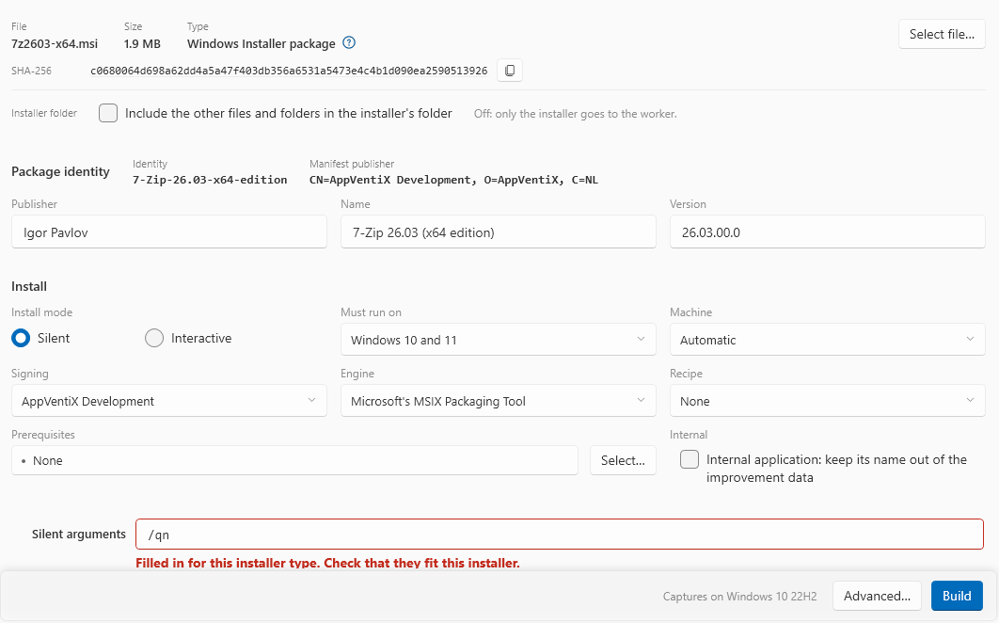
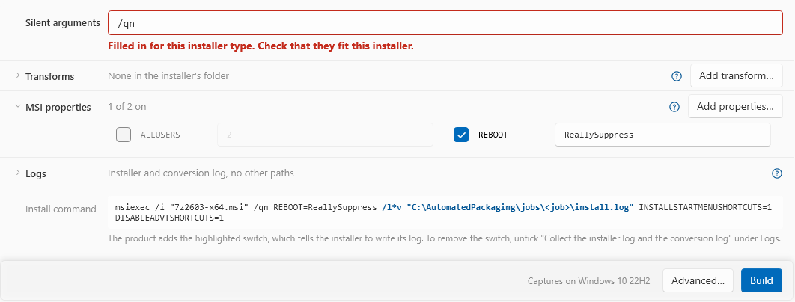

# Convert an installer

A job converts one installer into one signed MSIX package. The Build screen and the `convert` command use the same checks and the same job. The service **AppVentiX Automated Packaging** must run.

## Before the job: read the installer

You can see what the product reads from an installer before you start a job.

=== "GUI"

    Go to **Build**. Drop an MSI or EXE on the page, or click **Select file…**.

    The **Installer** card shows the file name, the size, the type and the full SHA-256. When the product knows the installer framework with high confidence, the type names it, for example "Windows executable · NSIS". The blue help mark beside it explains the silent switch of the framework.

    An MSI is also read for a driver and for a scheduled restart. A driver refuses the job before a worker is used.

=== "CLI"

    `inspect` shows what the Build screen shows, and what `convert` uses with no options:

    ```
    AutomatedPackaging.Cli inspect D:\installers\7z2408-x64.msi
    ```

    `check` lists what stops a conversion, as the Build screen lists it. It starts nothing:

    ```
    AutomatedPackaging.Cli check D:\installers\7z2408-x64.msi --certificate-thumbprint <thumbprint>
    ```

    `check` takes the same options as `convert`. It does not ask for a free worker. With `--machine`, it checks that worker, but not if it is busy.

## Set up the job

=== "GUI"

    The Build screen is one column of cards. The bar with **Build** stays at the bottom while the page scrolls.

    

    The **Installer** card shows the file, its size and type, the full SHA-256, and a check box for the installer's folder:

    | Setting | What it does |
    |---|---|
    | Installer's folder | "Include the other files and folders in the installer's folder". Off by default: then only the installer goes to the worker |

    **Package identity**:

    - **Publisher**, **Name** and **Version** come from the installer. An MSI gives its ProductName, Manufacturer and ProductVersion. An EXE gives the ProductName, CompanyName and ProductVersion of its version resource. A value that you type wins. An EXE that only wraps the installer gives none of them: then type them.
    - **Version** becomes four numbers, each 0 to 65535. Missing parts become zeros.
    - **Identity** shows beside the title. It is remembered. The same application gets the same identity next time, so a new package is an update.
    - **Manifest publisher**, also beside the title, comes from the signing certificate, not from the **Publisher** field.

    **Install** shows when you select a file. Each setting has its label above it. A wide window shows three settings in a row, a narrow window two:

    | Setting | What it does |
    |---|---|
    | **Install mode** | **Silent** runs the installer with its arguments. **Interactive** opens a window onto the worker, and you use the installer. See [Interactive installs](#interactive-installs) |
    | **Must run on** | The target: "Windows 10 and 11", "Windows 11 only" or "Windows Server". "Captures on …" beside **Build** names the image that the target needs |
    | **Machine** | **Automatic** lets the product select a free worker when the job starts. Or select one worker. A worker that is busy then refuses the job |
    | **Signing** | The certificate or Azure profile. A self-signed certificate shows **self-signed** |
    | **Engine** | The conversion engine. **Microsoft's MSIX Packaging Tool** is the default, from [Settings](settings.md#advanced). **Built-in engine (experimental)** is the product's own engine. It records what the installer changes, also across restarts of the worker, and writes the package on the host. It needs a worker whose image records the engine; other workers refuse the job (`AP-IM-026`). **Update** the worker to add it. A new version of an application uses the engine of the earlier job |
    | **Recipe** | **None** by default, or a recipe of this host. The line under the list shows its SHA-256. A new version of an application shows the recipe of the earlier job; **None** removes it. See [Recipes](recipes.md) |
    | **Prerequisites** | **Select…** selects prerequisites for this job only. The list shows one line for each item, and the label shows how many there are |
    | **Internal** | "Internal application: keep its name out of the improvement data". Off by default. Tick it for your own application. See [Settings](settings.md#improvement-data) |

    The install parameters are rows under the settings. **Silent arguments** is always open. A closed row shows in one line what it holds, for example "1 of 2 on". Click the name of a row to open or close it. **Transforms** and **MSI properties** open by themselves when a row in them is ticked.

    

    | Row | What it does |
    |---|---|
    | **Silent arguments** | Filled in for a known framework, for example `/qn` for an MSI. The installers of 7-Zip and WinRAR are recognised and get `/S`. Until you edit them, the box is red and a note under it asks you to check them for your installer |
    | **Transforms** | MSI only. Tick the `.mst` files to apply, or click **Add transform…** |
    | **MSI properties** | MSI only. `REBOOT=ReallySuppress` is ticked. **Add properties…** opens the full list of public properties. A value with a tab is put in quotes. A value with a line break cannot go on the install command: the screen says "Remove the line break from the value of `<NAME>`." |
    | **Logs** | "Collect the installer log and the conversion log" is on by default. Add other log paths, one on each line. The blue help mark explains what the job collects |
    | **Install command** | The full command as the worker runs it |

=== "CLI"

    ```
    AutomatedPackaging.Cli convert <installer> [options]
    ```

    | Option | Build screen | What it does |
    |---|---|---|
    | `--target <target>` | **Must run on** | `Windows10And11` (default), `Windows11Only` or `WindowsServer` |
    | `--machine <name>` | **Machine** | The worker to use, by name. See `machines`. A busy worker refuses the job |
    | `--certificate-thumbprint <thumbprint>` | **Signing** | Necessary when the host has more than one certificate |
    | `--signing-profile <id>` | **Signing** | An Azure profile that passed **Test**, instead of a certificate |
    | `--engine <engine>` | **Engine** | `mpt` for Microsoft's MSIX Packaging Tool, or `builtin` for the built-in engine (experimental). Without it, the default of **Settings > Advanced**. A name that the product does not know is refused before a worker is touched (`AP-IM-025`) |
    | `--internal` | **Internal** | Keeps the name of your own application out of the improvement data |
    | `--include-folder` | "Include the other files and folders in the installer's folder" | Sends the other files and folders in the installer's folder |
    | `--interactive` | **Install mode** | You use the installer in a window onto the worker. See [Interactive installs](#interactive-installs) |
    | `--arguments <text>` | **Silent arguments** | Necessary for an EXE, for example `"/S"` |
    | `--msi-property <NAME=VALUE>` | **MSI properties** | MSI only. You can give it more than once. A value with a tab is put in quotes. A value with a line break is refused: `check` says "Remove the line break from the value of `<NAME>`." |
    | `--transform <path>` | **Transforms** | MSI only. Applied in the order given |
    | `--prerequisite <PRQ-nnn>` | **Prerequisites** | You can give it more than once |
    | `--no-install-log` | **Logs** | Does not collect the verbose conversion log |
    | `--collect-log <path>` | **Logs** | A log file in the worker to collect. You can give it more than once |
    | `--name <text>` | **Name** | Default: the ProductName of the MSI or of the version resource of the EXE |
    | `--publisher <text>` | **Publisher** | Default: the Manufacturer of the MSI, or the CompanyName of the EXE |
    | `--package-version <version>` | **Version** | Default: the ProductVersion of the MSI or of the EXE |

    The options of the **Advanced** dialog are in the next section. [Command line](command-line.md) has all options.

## Advanced settings

These settings apply to one job.

=== "GUI"

    Click **Advanced…**. Each value shows where it comes from: "product default", or "overridden for this job". **OK** keeps the changes. **Cancel** keeps none. **Reset to defaults** clears them.

=== "CLI"

    Give the options below to `convert` or `check`.

| Setting | Option | What it does | Allowed values |
|---|---|---|---|
| First-start capture | `--first-launch` | After the installer, the capture starts the application one time. Then the package also contains what the application writes at the first start | On or off (default off) |
| First-start settle time | `--settle-seconds <n>` | How long the application runs at that first start before the job closes it | 1 to 600 seconds (default 20) |
| Valid installer exit codes | `--exit-codes <list>` | Exit codes that mean success. 3010 and 1641 are refused here | Default `0` |
| Additional exclusions | `--exclude <path>` | Files, folders or registry keys that the capture leaves out, in addition to the other exclusions | A rule as on [Settings > Exclusions](settings.md#exclusions): a full path, `%USERPROFILE%\...`, `HKLM\...`, `HKCU\...` or `SERVICE\name` |
| Minimum free disk space | `--min-free-disk-gb <n>` | Free space that the worker needs before the capture | 1 to 1024 GB (default 10) |
| Packaging tool timeout | `--timeout-minutes <n>` | How long the packaging tool can take | 5 to 480 minutes (default 40) |
| Package identity | `--package-name <name>` | The Name of the package. To Windows, a different Name is a different application | 3 to 50 characters: letters, digits, `.` and `-` |
| Export the package | `--export`, `--no-export` | Copies the package to the export location. See [Export packages](export.md) | Default: the Settings value |
| Package Support Framework | `--psf`, `--no-psf` | Puts PSF in front of the programs of the package. See [Package Support Framework](settings.md#package-support-framework). Without PSF on this host, the job stops with `AP-PK-011` after the capture | On or off (default off) |
| Restarts | `--restarts <n>` | How many times the worker can restart during a capture with the built-in engine. The installer, you or a shutdown can cause a restart. One restart more stops the job with `AP-IN-020` | 1 to 10 (default 3) |
| Wait after a restart (minutes) | `--restart-wait-minutes <n>` | How long a capture with the built-in engine waits for the worker after a restart or a shutdown. If the worker is off, start it in this time. A restart that installs updates can take longer | 5 to 30 minutes (default 5) |

Network mode shows on the Advanced dialog, and only host-only is available.

On the command line, a `--package-name` that is different from the last Name of this application is refused. Add `--change-identity` to build it. Users with the old package do not get the new package as an update.

## Start the job

=== "GUI"

    Click **Build**.

    - If **Build** is not available, the bar at the bottom shows each reason on its own line, with a warning mark.
    - If **Build** in the navigation is not available, the host needs preparation first.
    - Lines with an information mark are notes that block nothing. For example, an MSI that declares a service (`AP-AN-011`), or that schedules a restart (`AP-AN-010`).

    While the job runs, the bar shows the steps, the time and the current step. **Open in Jobs** selects the job on the **Jobs** screen. **Cancel** stops the job.

    At the end, the screen says "Built `<file>` in `<folder>`." or "Failed `<code>`: …".

=== "CLI"

    Run from an elevated prompt:

    ```
    AutomatedPackaging.Cli convert D:\installers\7z2408-x64.msi --certificate-thumbprint <thumbprint> --target Windows10And11 --export
    ```

    For an EXE, give the name, publisher, version and silent arguments:

    ```
    AutomatedPackaging.Cli convert D:\installers\setup.exe --name "Contoso Editor" --publisher Contoso --package-version 4.2 --arguments "/S" --certificate-thumbprint <thumbprint> --json
    ```

    The command shows the job log while it runs, then the result. The exit code tells a script the result: 0 is built, 1 is refused, 2 is failed. See [Exit codes](command-line.md#exit-codes).

    The first Ctrl+C cancels the job, and the service puts the worker back. A second Ctrl+C ends the program at once.

The **Jobs** screen shows each job and its log, from the window, the command line and MCP.

## The installer and its files

- **Silent arguments.** A known framework gets its usual switches. Some installers need more. An EXE with no arguments is refused, because it would wait on a dialog until the job times out.
- **msiexec switches.** For an MSI, a switch that msiexec does not know is refused before the job, for example `/noreboot`. The message gives the msiexec switch when there is one, for example `/norestart`. A value with a `"` in an MSI property is written with the quote doubled, as msiexec reads it. A transform name with `;`, or that starts with `@`, `|` or `:`, is refused.
- **The folder beside the installer.** Only the installer goes to the worker, unless you include the folder. Include it for an MSI with external `.cab` files, or a `setup.exe` with a data folder. The limits are 4 GB and 20,000 files. A drive root or a folder with a link is refused.
- **Restarts.** `REBOOT=ReallySuppress` stops an MSI from restarting the worker. Untick it only for an installer that needs it.
- **Logs.** For an MSI, an Inno Setup or a WiX Burn installer, the job also collects the log of the installer as `install.log`. A log larger than 32 MB is not collected. A job collects at most 64 files and 256 MB.

Leave the installer and its folder unchanged while the job runs. The job checks each file again when it sends it, and stops with `AP-IN-015` or `AP-IN-016` if a file changed.

## What the job does

1. It takes a free worker for the target, and puts it back to `baseline`.
2. It sends the installer to the worker, and starts the agent.
3. It runs the pre-flight checks, then the capture with the MSIX Packaging Tool or the built-in engine.
4. It collects the logs from the worker, also when the capture fails.
5. On the host, it unpacks, checks, corrects and signs the package.
6. Smoke test: it puts the worker back to `baseline`, installs the signed package and starts the application.
7. It puts the worker back to `baseline`. It always does this: after success, failure, timeout or cancel.

A job tries again once, by itself, only after a lost connection, an agent that stopped, or a worker that stopped.

The smoke test passes when a program of the package starts and still runs a minute later. When every application of the package is a service, the smoke test starts the service instead.

## Interactive installs

Use this for an installer that has no silent mode. The job does not run the installer. You use it, in a window onto the worker.

The image must have the shortcut **Finish packaging** on the desktop of the worker. An image built or updated before this release does not have it, and the job stops before it touches a worker with `AP-IM-024`. Click **Update** for the worker on the **Workers** screen. See [Maintain images](maintain-images.md).

=== "GUI"

    1. Under **Install**, select **Interactive** for **Install mode**. The silent arguments and the MSI properties are not used.
    2. Click **Build**. When the job starts, the application shows the **Jobs** screen with the job selected. The window onto the worker opens only while the job is selected there. The job reverts the worker, copies the installer to it, and starts the capture.
    3. The Jobs screen says "The worker waits for you", and the window onto the worker opens (**Virtual Machine Connection**). The folder with the installer is open in it. If you close the window, click **Open the worker's window** on the card of the job.

=== "CLI"

    ```
    AutomatedPackaging.Cli convert D:\installers\setup.exe --name "Contoso Editor" --publisher Contoso --package-version 4.2 --interactive
    ```

    The command line opens the window onto the worker when the job waits, also with `--json`. `--arguments` and `--first-launch` are refused with `--interactive`.

The window shows the desktop of the worker. You do not sign in. Then, in the worker:

1. Run the installer, and use it as you would on a computer.
2. Start the application one time, so the package also has what it writes when it starts first.
3. On the desktop, double-click **Finish packaging**. It asks one time. Click **Finish packaging**, or **Not yet** to go on.

Everything that you do from the time that the folder opens until you click **Finish packaging** goes into the package. The job then makes, signs and smoke-tests the package as for a silent install.

| Limit | What to do |
|---|---|
| A restart, with the packaging tool | The MSIX Packaging Tool cannot continue a capture after a restart. If the installer asks for one, select the option to restart later. Its `RunOnce` work runs in the capture. A restart of Windows fails the job with `AP-IN-009` |
| A restart, with the built-in engine | Use the built-in engine for an installer that must restart: see [A restart in an interactive install](#a-restart-in-an-interactive-install) |
| When the window opens | The window opens when the worker is ready. The job log says that the worker prepares the capture. The capture first records the worker as it is. This takes some minutes. Then the window and the folder with the installer open. Do not install before this: the package would not contain it |
| A lost worker | A job that loses the worker is not tried again. A silent job is tried one more time after a connection loss. An interactive job is not, because the revert removes what you installed. Start the job again |
| Time | The job waits 120 minutes for **Finish packaging**, unless you set another time for the packaging tool in **Advanced** (`--timeout-minutes`). The time includes the restarts. Then it stops with `AP-IN-017` |
| Cancel | **Cancel job** works while the job waits. The worker goes back to its baseline |
| Network | The worker reaches only the host. An installer that must activate online cannot do that |
| A licence key | In the window onto the worker, use **Clipboard > Type clipboard text** |
| AI agents | The MCP `convert` tool has no install mode. An agent cannot start an interactive job |

### A restart in an interactive install

With the built-in engine, the capture continues after a restart of the worker.

=== "GUI"

    Under **Install**, select **Interactive** for **Install mode**, and **Built-in engine (experimental)** for **Engine**. Then click **Build**.

=== "CLI"

    ```
    AutomatedPackaging.Cli convert D:\installers\setup.exe --name "Contoso Editor" --publisher Contoso --package-version 4.2 --interactive --engine builtin
    ```

In the worker:

1. Run the installer. When it asks for a restart, let it restart. You can also click **Restart first** in the **Finish packaging** dialog, or restart Windows yourself.
2. The worker signs in again by itself. The window onto the worker stays open, and the log of the job says that the capture continues. The folder with the installer does not open again.
3. The worker completes the `RunOnce` work of the installer. Do what you must do after the restart, and start the application one time.
4. Double-click **Finish packaging** again, and click **Finish packaging**.

The package holds what you did before and after the restart.

- The capture can have 3 restarts. Set 1 to 10 in **Advanced**, under **Restarts** (`--restarts`). One restart more stops the job with `AP-IN-020`.
- After a restart, **Finish packaging** says that no job waits until the capture is ready again. Then use it as before.
- If you shut down the worker, start it again in the window onto the worker. The job waits 5 minutes for this. Set 5 to 30 minutes in **Advanced**, under **Wait after a restart** (`--restart-wait-minutes`). The capture then continues as after a restart, and it counts as one. A worker that stays off longer, or that had a stop error, stops the job.

## Installers that ask for a restart

The worker does not restart during a capture. When an installer exits with 3010 or 1641, the product runs the `RunOnce` work of the installer in the capture. The package then holds the result. The job succeeds with a warning that names the commands.

Two things refuse the package with `AP-IN-013`:

- files that the installer replaces or deletes at the next start,
- `RunOnceEx` work.

An installer that restarts Windows by itself fails the job with `AP-IN-009`. Use an interactive job on the built-in engine for it: see [A restart in an interactive install](#a-restart-in-an-interactive-install).

## More than one job at a time

- One job runs on one worker. Two workers can run two jobs at the same time.
- With **Automatic**, the second job gets another free worker for its target.
- A job for a busy, selected worker is refused with `AP-HV-007`.
- You can close the window. The job continues in the service.
- Before a job starts, the window or the command line copies the installer to `<workingDir>\Jobs\_handover\`. The service cannot see your mapped drives.

## Where the results go

| What | Where |
|---|---|
| The package | `<workingDir>\Packages\<PackageName>_<Version>.msix` |
| Notes of the package | `<PackageName>_<Version>.notes.txt` and `.PackageInfo.json`, beside the package |
| The job log | `<workingDir>\jobs\<job id>\job.log`, and on the **Jobs** screen |
| Collected logs | `<workingDir>\jobs\<job id>\Collected files\` |
| What the built-in engine found | `<workingDir>\jobs\<job id>\engine\`. See below |

### What the built-in engine found

A job on the built-in engine writes these files in `<workingDir>\jobs\<job id>\engine\`. The text comes from the worker.

| File | What it holds |
|---|---|
| `difference.txt` | The files and registry values that the capture found |
| `noise-removed.txt` | What the noise rules and the calibration removed, with the rule. In this file and in `difference.txt`, a tab or a line break in a name shows as `\t`, `\r` or `\n` |
| `attribution.txt` | The processes that wrote each change (ETW) |
| `writer-evidence.json` | What the package writer made, left out or changed, and why |
| `failed-step.txt` | The step that stopped the job. It is there only when the job made no package |

The MCP tool `engine_evidence` gives a summary of these files.

By default, the engine removes each entry that the installer did not write, when the trace is complete. To keep these entries in the package, set `"etwRemoval": false` in `host.json` in `%ProgramData%\AppVentiX\Automated Packaging`. Then start the next job. The entries are then listed only, as "ETW would remove". Do this if a package misses a change that Windows made for the installer.

Next: [Jobs and packages](jobs.md).
