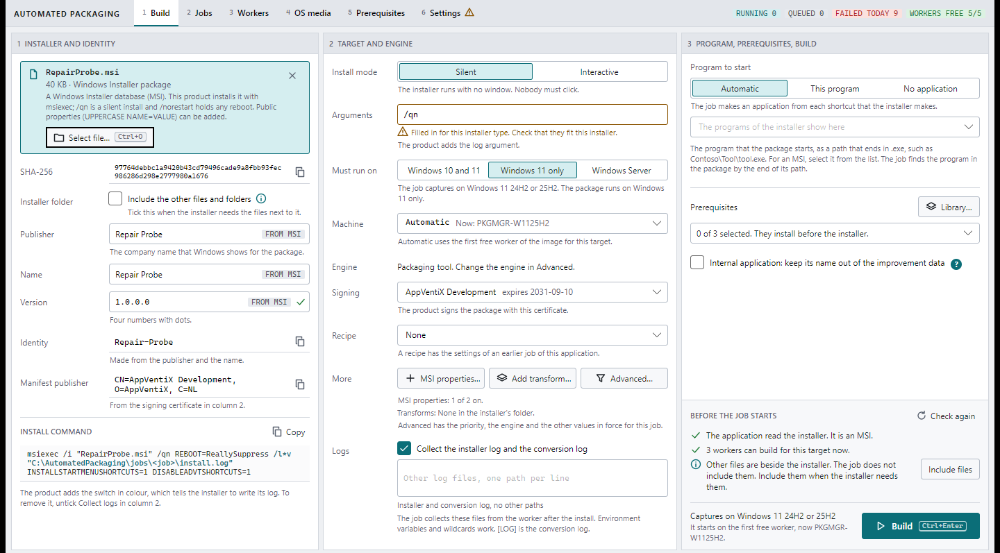
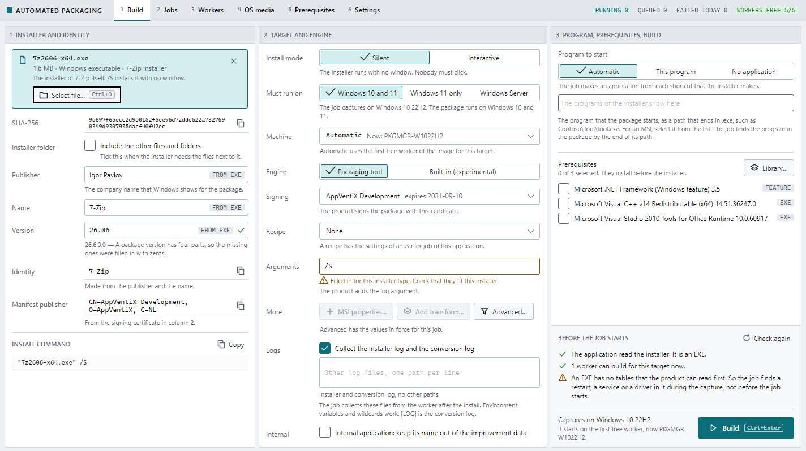
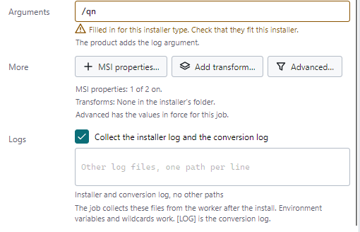
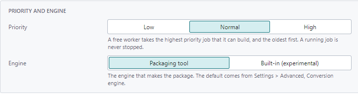

# Convert an installer

A job converts one installer into one signed MSIX package. The Build screen and the `convert` command use the same checks and the same job. The service **AppVentiX Automated Packaging** must run.

## Before the job: read the installer

You can see what the product reads from an installer before you start a job.

=== "GUI"

    Click the **Build** tab (Ctrl+1). Drop an MSI or EXE on the page, or click **Select file…** (Ctrl+O).

    The box of the installer, in column 1, shows the file name, the size, the type and the full SHA-256. When the product knows the installer framework with high confidence, the type names it, for example "Windows executable · NSIS". A line under it explains the silent switch of the framework.

    An MSI is also read for a driver and for a scheduled restart. A driver refuses the job before a worker is used.

=== "CLI"

    `inspect` shows what the Build screen shows, and what `convert` uses with no options:

    ```
    AutomatedPackaging.Cli inspect D:\installers\7z2408-x64.msi
    ```

    `check` lists what stops a conversion, as the Build screen lists it. It starts nothing:

    ```
    AutomatedPackaging.Cli check D:\installers\7z2408-x64.msi --certificate-thumbprint <thumbprint>
    ```

    `check` takes the same options as `convert`. It does not ask for a free worker. With `--machine`, it checks that worker, but not if it is busy.

## Set up the job

=== "GUI"

    The Build screen has three columns, and each column scrolls. The bar with **Build** stays at the bottom of column 3. Until you select a file, columns 2 and 3 are grey.

    

    Column 1 shows the file, its size and type, the full SHA-256, and a check box for the installer's folder:

    | Setting | What it does |
    |---|---|
    | **Installer folder** | "Include the other files and folders". Off by default: then only the installer goes to the worker. The product ticks it for you when the `Media` table of the MSI names a cabinet beside the MSI. A line under the box tells which cabinet. When you remove the tick, the product does not tick it again for this installer. A mark after the box tells you more: point to it, or press Tab to it. A warning mark and an orange border tell you that the job fails. The MSI then needs a cabinet that is not included or not beside the MSI. An information mark and a blue border tell you that other files are beside the installer and the job does not include them. The same text shows in the list above **Build**, with a button: **Include files** ticks the box. The marks do not turn **Build** off |

    The identity of the package is in column 1 too:

    - **Publisher**, **Name** and **Version** come from the installer. An MSI gives its ProductName, Manufacturer and ProductVersion. An EXE gives the ProductName, CompanyName and ProductVersion of its version resource. A value that you type wins. An EXE that only wraps the installer gives none of them: then type them. When the Name holds the version of the installer, a short warning under **Name** says that the package identity is made from the name and never changes. You decide; the product changes nothing.
    - **Version** becomes four numbers, each 0 to 65535. Missing parts become zeros.
    - **Identity** shows under **Version**. It is remembered. The same application gets the same identity next time, so a new package is an update.
    - **Manifest publisher**, under **Identity**, comes from the signing certificate, not from the **Publisher** field.
    - **Install command**, under the identity, shows the full command as the worker runs it.

    

    Columns 2 and 3 have the settings. You can use them after you select a file. Each setting has its label at its left:

    | Setting | What it does |
    |---|---|
    | **Install mode** | **Silent** runs the installer with its arguments. **Interactive** opens a window onto the worker, and you use the installer. See [Interactive installs](#interactive-installs) |
    | **Arguments** | Under **Install mode**. See the install parameters below |
    | **Must run on** | The target: "Windows 10 and 11", "Windows 11 only" or "Windows Server". "Windows 11 only" is the default. On a host with only a Windows 10 image, select "Windows 10 and 11". "Captures on …" beside **Build** names the image that the target needs |
    | **Machine** | **Automatic** lets the product select a free worker when the job starts. It looks at the images for the target in order: the healthiest first, then the most recently calibrated. It takes the first free worker of an image that can build the job. Or select one worker. **Recommended** marks the worker that Automatic would select for the selected **Engine** and **Install mode**. The mark moves when you change one of them. **busy** marks a worker that runs a job. A job for a busy worker waits in the queue for that worker. A worker that the job cannot use is in the list too, without the mark. For example, its agent is too old for the job. With the **CIM** disk format, the list leaves out a worker of a build below 26100. The planner would refuse it (`AP-PK-030`) |
    | **Signing** | The certificate or Azure profile. A self-signed certificate shows **SELF-SIGNED** |
    | **Engine** | A line shows the conversion engine of the job. Change it in **Advanced…**, under **Priority**. The default is in [Settings](settings.md#advanced). A new installation starts with **Built-in (experimental)**. An upgrade keeps the default of the host: **Packaging tool** if nobody saved one. **Built-in (experimental)** is the product's own engine. It records what the installer changes, also across restarts of the worker, and writes the package on the host. It needs a worker whose image records the engine; other workers refuse the job (`AP-IM-026`). **Update** the worker to add it. A new version of an application uses the engine of the earlier job |
    | **Recipe** | **None** by default, or a recipe of this host. The line under the list shows its SHA-256. A new version of an application shows the recipe of the earlier job; **None** removes it. See [Recipes](recipes.md) |
    | **Program to start** | In column 3. One of three. **Automatic**, the default: the job makes an application from each shortcut that the installer makes. **This program**: the job adds an application on the program that you select in the list or type, for example `Contoso\Tool\tool.exe`, and the start test starts it. **No application**: the package gets no application. See [The program to start](#the-program-to-start) |
    | **No application** | The package gets no application, so nothing in it can start. Only a service or a shell extension in it still works. The job installs the package on the worker and removes it again, instead of the start test, and warns |
    | **Prerequisites** | In column 3. Tick the prerequisites for this job only. They are in a drop-down; its face shows how many you selected. Open it with Enter, Space or Alt+Down, tick with Space, close it with Esc. **Library…** opens the **Prerequisites** tab |
    | **Internal** | In column 3, under **Prerequisites**. "Internal application: keep its name out of the improvement data". Off by default. Tick it for your own application. The improvement data then has no name and no version for its jobs, and records that the application is internal. Nothing else changes. The blue question mark after the choice gives the same help: point to it, or press Tab to it. See [Settings](settings.md#improvement-data) |

    **Arguments** is under **Install mode**. **More** and **Logs** are at the bottom of column 2. **More** has **MSI properties…**, **Add transform…** and **Advanced…** in one row, and each opens a window. Lines under them show what the job has, for example "MSI properties: 1 of 2 on."

    

    | Parameter | What it does |
    |---|---|
    | **Arguments** | Filled in for a known framework, for example `/qn` for an MSI. The installers of 7-Zip and WinRAR are recognised and get `/S`. Until you edit them, the box has a border in the warning colour. A note under it asks you to check them for your installer |
    | **Add transform…** | MSI only. Opens the **Transforms** window. Tick the `.mst` files to apply, or click **Browse…** to select others. Then click **Use these**. When transforms are beside the MSI and none is ticked, an information mark shows after the **Transforms** line, and a line above **Build** says so. Its button **Apply transform** ticks the one transform. With more than one, **Select transforms** opens the **Transforms** window |
    | **MSI properties…** | MSI only. Opens a window, where `REBOOT=ReallySuppress` is ticked. The window has the full list of public properties of the installer, with a filter. Click **Use these**. A value with a tab is put in quotes. A value with a line break cannot go on the install command: the screen says "Remove the line break from the value of `<NAME>`." |
    | **Logs** | "Collect the installer log and the conversion log" is on by default. Add other log paths, one on each line. The lines under the box explain what the job collects |

=== "CLI"

    ```
    AutomatedPackaging.Cli convert <installer> [options]
    ```

    | Option | Build screen | What it does |
    |---|---|---|
    | `--target <target>` | **Must run on** | `Windows11Only` (default), `Windows10And11` or `WindowsServer`. On a host with only a Windows 10 image, a job without `--target` is refused: "No image can build for Windows 11 only". Give `--target Windows10And11` |
    | `--machine <name>` | **Machine** | The worker to use, by name. See `machines`. A job for a busy worker waits for it |
    | `--certificate-thumbprint <thumbprint>` | **Signing** | Necessary when the host has more than one certificate |
    | `--signing-profile <id>` | **Signing** | An Azure profile that passed **Test**, instead of a certificate |
    | `--engine <engine>` | **Engine** | `mpt` for Microsoft's MSIX Packaging Tool, or `builtin` for the built-in engine (experimental). Without it, the default of **Settings > Advanced**. A name that the product does not know is refused before a worker is touched (`AP-IM-025`) |
    | `--application <path>` | **Program to start** | The program that the package starts, as a path that ends in `.exe`. `inspect` lists the programs of an MSI |
    | `--no-application` | **No application** | Builds the package with no application. The job installs and removes it instead of the start test |
    | `--internal` | **Internal** | Keeps the name of your own application out of the improvement data |
    | `--include-folder` | **Installer folder**: "Include the other files and folders" | Sends the other files and folders in the installer's folder |
    | `--interactive` | **Install mode** | You use the installer in a window onto the worker. See [Interactive installs](#interactive-installs) |
    | `--arguments <text>` | **Arguments** | Necessary for an EXE, for example `"/S"` |
    | `--msi-property <NAME=VALUE>` | **MSI properties…** | MSI only. You can give it more than once. A value with a tab is put in quotes. A value with a line break is refused: `check` says "Remove the line break from the value of `<NAME>`." |
    | `--transform <path>` | **Add transform…** | MSI only. Applied in the order given |
    | `--prerequisite <PRQ-nnn>` | **Prerequisites** | You can give it more than once |
    | `--no-install-log` | **Logs** | Does not collect the verbose conversion log |
    | `--collect-log <path>` | **Logs** | A log file in the worker to collect. You can give it more than once |
    | `--name <text>` | **Name** | Default: the ProductName of the MSI or of the version resource of the EXE |
    | `--publisher <text>` | **Publisher** | Default: the Manufacturer of the MSI, or the CompanyName of the EXE |
    | `--package-version <version>` | **Version** | Default: the ProductVersion of the MSI or of the EXE |

    The options of the **Advanced** window are in the next section. [Command line](command-line.md) has all options.

## The output: MSIX, AppGo or App Attach

A job makes one package. **Output** is the first row of column 2:

- **MSIX**: a signed MSIX package. The job starts it on a clean worker before it ends. This is the default.
- **AppGo**: an AppVentiX AppGo package, one `.appgo` file. The AppGo Capture Tool of AppVentiX records the
  installation. The host names the file `<PackageName>_<Version>.appgo` from the job's package name and four-part
  version, for example `7-Zip-26.03-x64-edition_26.3.0.0.appgo`. It does not use the name that the tool gave. An AppGo package is for Windows 11 only. It is not signed. This version does not start it on a clean
  worker: the job ends with the warning "Not tested". Test the package with AppVentiX before you give it to users.
- **App Attach**: an App Attach image of the signed MSIX package, as a VHDX or CIM file, with an AppVentiX
  `.appattach` file. The job builds, signs and tests the MSIX package as usual. Then the host writes the image from
  it. No Microsoft tool is used. The worker then starts the package from the image.

For AppGo and App Attach, select the **Disk format**:

- **VHDX** (the default).
- **CIM**. A CIM job needs a worker of Windows 11 24H2 (build 26100) or later. The product gives the job the worker
  with the lowest such build. When no worker has that build, the job is refused (`AP-PK-030`).

An AppGo job is silent. It cannot be interactive, continue from an earlier capture, or test a package. A recipe fills
the values of the job, but its packaging rules are for MSIX and are not used. The job installs its prerequisites
before the capture.

An App Attach job is an MSIX job first: it needs a signing certificate, and every MSIX setting applies. A VHDX image
runs on the targets of the MSIX package. A CIM image runs on Windows 11 only. An App Attach job cannot be signed with a
test certificate of an AI agent, and cannot test a package (`AP-PK-030`). Retry signing and Sign for release are not
offered for an App Attach job: build it again.

After the smoke test of the MSIX package, the worker goes back to its baseline once more. It mounts the image, stages
and registers the package from it, and starts its application. This takes about a minute more than an MSIX job. When
the worker cannot stage the package from the image, the job stops with `AP-PK-036`. When the application does not
start, it stops with `AP-PK-037`.

=== "GUI"

    Click **AppGo** in the **Output** row. **Disk format** shows under it. The MSIX settings are not used for AppGo:
    **Engine** and **Signing** go away, and **Publisher**, the identity and **Program to start** are grey.
    **Must run on** must be **Windows 11 only**.

    For App Attach, click **App Attach** in the **Output** row. **Disk format** shows under it. The MSIX settings stay,
    with **Signing**. For CIM, set **Must run on** to **Windows 11 only**.

=== "CLI"

    Give `--output appgo`, and `--disk-format cim` for CIM. Without `--target`, the target is `windows11only`.
    An AppGo job needs no certificate.

        AutomatedPackaging.Cli convert D:\Installers\7z2603-x64.msi --output appgo --disk-format cim

    `check` takes the same options. `schedule add` takes `--output appgo` and `--disk-format`, and then needs no
    `--signing-profile`. MCP `convert`, `check_job` and `schedule_package` take `output` and `diskFormat`.

    For App Attach, give `--output appattach`, and `--disk-format cim` for CIM. Without `--target`, a CIM job gets
    `windows11only`. Name the certificate as for an MSIX job.

        AutomatedPackaging.Cli convert D:\Installers\7z2603-x64.msi --output appattach --disk-format vhdx --certificate-thumbprint <thumbprint>

    `check`, `schedule add` and MCP `convert`, `check_job` and `schedule_package` take the same values.

## The program to start

A package starts a program through an application in its manifest. The product makes an application from each shortcut that the installer makes. An installer with no shortcut gives a package with no application, and the job fails with `AP-PK-005`.

For an MSI, the product reads the shortcuts before the job, with the ticked transforms. A shortcut to a document or a folder does not count. When the MSI installs a program and no shortcut starts one, the job is refused with `AP-AN-015` before a worker starts. Then select the program, or select **No application**. An MSI that installs a service is not refused: the package carries the service. When a custom action of the MSI runs one of its own programs, `AP-AN-015` is only a note, and the job goes on: that program can make the shortcut. If the package then has no application, the job fails with `AP-PK-005`, and the detail names the programs.

For an EXE installer, the product cannot read the shortcuts first. Give the program only when you know that the installer makes no shortcut.

The job finds the program in the package by the end of its path. So the program is found also when the installation folder is different. When two files agree with the path, give more of it. The application stays on the Start list, with the name of the package. When the capture already has an application on the same program, the job keeps it. In both cases the job puts the application first, and the start test starts that program. When the capture hid the application in Start, the job shows it.

=== "GUI"

    Under **Program to start**, select one of three:

    - **Automatic** (the default). The job makes an application from each shortcut that the installer makes.
    - **This program.** Select the program in the list under it, or type its path. A click in the field, Alt+Down or F4 opens the list. When the list is empty, a line in it tells you to type the path. For an EXE installer, type the path. When you select or type a program, **This program** turns on. With no program, the screen shows "Select or type the program to start." and **Build** is not available.
    - **No application.** The package gets no application, so nothing in it can start. Only a service or a shell extension in it still works. The job installs and removes the package on the worker instead of the start test. The screen shows this text only when **No application** is on.

    When an MSI shows `AP-AN-015`, select **This program** and a program, or **No application**. The product does not select a program for you. A new version of an application takes the choice of the earlier job.

=== "CLI"

    ```
    AutomatedPackaging.Cli inspect setup.msi
    AutomatedPackaging.Cli convert setup.msi --application "Contoso\Tool\tool.exe"
    AutomatedPackaging.Cli convert setup.msi --no-application
    ```

    `inspect` shows **Shortcuts** and **Programs** for an MSI. `--application` and `--no-application` cannot go together.

## Advanced settings

These settings apply to one job.

=== "GUI"

    Click **Advanced…**, under **More** in column 2. **Priority** and **Engine** are at the top: see [Start the job](#start-the-job) and **Engine** above. Each other value shows where it comes from: "product default", or "overridden for this job". **OK** keeps the changes. **Cancel** keeps none. **Reset to defaults** clears them, and sets **Normal** and the default engine.

=== "CLI"

    Give the options below to `convert` or `check`.

| Setting | Option | What it does | Allowed values |
|---|---|---|---|
| First-start capture | `--first-launch` | After the installer, the capture starts the application one time. Then the package also contains what the application writes at the first start | On or off (default off) |
| First-start settle time | `--settle-seconds <n>` | How long the application runs at that first start before the job closes it | 1 to 600 seconds (default 20) |
| Valid installer exit codes | `--exit-codes <list>` | Exit codes that mean success. 3010 and 1641 are refused here | Default `0` |
| Additional exclusions | `--exclude <path>` | Files, folders or registry keys that the capture leaves out, in addition to the other exclusions | A rule as on [Settings > Exclusions](settings.md#exclusions): a full path, `%USERPROFILE%\...`, `HKLM\...`, `HKCU\...` or `SERVICE\name` |
| Minimum free disk space | `--min-free-disk-gb <n>` | Free space that the worker needs before the capture | 1 to 1024 GB (default 10) |
| Packaging tool timeout | `--timeout-minutes <n>` | How long the packaging tool can take | 5 to 480 minutes (default 40) |
| Package identity | `--package-name <name>` | The Name of the package. To Windows, a different Name is a different application | 3 to 50 characters: letters, digits, `.` and `-` |
| Export the package | `--export`, `--no-export` | Copies the package to the export location. See [Export packages](export.md) | Default: the Settings value |
| Package Support Framework | `--psf`, `--no-psf` | Puts PSF in front of the programs of the package. See [Package Support Framework](settings.md#package-support-framework). Without PSF on this host, the job stops with `AP-PK-011` after the capture. An AppGo job does not use PSF. The window shows the choice as off, with a line that says so | On or off (default off) |
| Restarts | `--restarts <n>` | How many times the worker can restart during a capture with the built-in engine. The installer, you or a shutdown can cause a restart. One restart more stops the job with `AP-IN-020` | 1 to 10 (default 3) |
| Wait after a restart (minutes) | `--restart-wait-minutes <n>` | How long a capture with the built-in engine waits for the worker after a restart or a shutdown. If the worker is off, start it in this time. A restart that installs updates can take longer | 5 to 30 minutes (default 5) |

Network mode shows in the **Advanced** window, and only host-only is available.

On the command line, a `--package-name` that is different from the last Name of this application is refused. Add `--change-identity` to build it. Users with the old package do not get the new package as an update.

## Start the job

=== "GUI"

    To change the priority, click **Advanced…** in column 2. Select **Priority** at the top: **Low**, **Normal** (the default) or **High**, and click **OK**. Then click **Build** at the bottom of column 3.

    

    - If **Build** is not available, the bar at the bottom of column 3 shows each reason on its own line. Each has a red warning mark. Under the reasons, at the left of **Build**, "Captures on …" names the image that the target needs.
    - If the **Build** tab is grey, the host needs preparation first.
    - Lines with an orange warning mark are notes that block nothing. For example, an MSI that declares a service (`AP-AN-011`), or that schedules a restart (`AP-AN-010`).

    The job goes into the queue of the service, and starts when a worker is free. While the job runs, the bar shows the steps, the time and the current step. **Open in Jobs** selects the job on the **Jobs** screen. **Cancel** stops the job. When the job ends, its result stays at the bottom of the bar.

    At the end, the screen says "Built `<file>` in `<folder>`." or "Failed `<code>`: …".

=== "CLI"

    Run from an elevated prompt:

    ```
    AutomatedPackaging.Cli convert D:\installers\7z2408-x64.msi --certificate-thumbprint <thumbprint> --target Windows10And11 --export
    ```

    For an EXE, give the name, publisher, version and silent arguments:

    ```
    AutomatedPackaging.Cli convert D:\installers\setup.exe --name "Contoso Editor" --publisher Contoso --package-version 4.2 --arguments "/S" --certificate-thumbprint <thumbprint> --json
    ```

    The job goes into the queue of the service, and starts when a worker is free. `--priority low|normal|high` sets how soon a free worker takes it. The command shows the job log while it runs, then the result. The exit code tells a script the result: 0 is built, 1 is refused, 2 is failed. See [Exit codes](command-line.md#exit-codes).

    With `--no-wait`, the command gives the job ID when the job is in the queue, and does not wait. `status <job-id>` shows the job later, and `status <job-id> --wait` waits for its end.

    The first Ctrl+C cancels the job, and the service puts the worker back. A second Ctrl+C ends the program at once.

The **Jobs** screen shows each job and its log, from the window, the command line and MCP.

## The installer and its files

- **Arguments.** A known framework gets its usual switches. Some installers need more. An EXE with no arguments is refused, because it would wait on a dialog until the job times out.
- **msiexec switches.** For an MSI, a switch that msiexec does not know is refused before the job, for example `/noreboot`. The message gives the msiexec switch when there is one, for example `/norestart`. A value with a `"` in an MSI property is written with the quote doubled, as msiexec reads it. A transform name with `;`, or that starts with `@`, `|` or `:`, is refused.
- **The folder beside the installer.** Only the installer goes to the worker, unless you include the folder. Include it for an MSI with external `.cab` files, or a `setup.exe` with a data folder. The limits are 4 GB and 20,000 files. A drive root or a folder with a link is refused.
- **Restarts.** `REBOOT=ReallySuppress` stops an MSI from restarting the worker. Untick it only for an installer that needs it.
- **Logs.** For an MSI, Inno Setup, WiX Burn, InstallShield or Advanced Installer setup, the job also collects the log of the installer as `install.log`. For InstallShield, the job puts `/l*v` in the `/v"..."` part of the arguments. With no `/v"..."` part, it adds no switch. A log larger than 32 MB is not collected. A job collects at most 64 files and 256 MB.

Leave the installer and its folder unchanged while the job runs. The job checks each file again when it sends it, and stops with `AP-IN-015` or `AP-IN-016` if a file changed.

## What the job does

1. It takes a free worker for the target, and puts it back to `baseline`.
2. It sends the installer to the worker, and starts the agent.
3. It runs the pre-flight checks, then the capture with the MSIX Packaging Tool or the built-in engine.
4. It collects the logs from the worker, also when the capture fails.
5. On the host, it unpacks, checks, corrects and signs the package.
6. Smoke test: it puts the worker back to `baseline`, installs the signed package and starts the application.
7. It puts the worker back to `baseline`. It always does this: after success, failure, timeout or cancel.

A job tries again once, by itself, only after a lost connection, an agent that stopped, or a worker that stopped.

The smoke test starts the first application that the package shows in Start and that is not the program of a service. When the job names the program to start, that application is first. The smoke test passes when a program of the package starts and still runs a minute later. When every application of the package is a service, the smoke test starts the service instead.

## Interactive installs

Use this for an installer that has no silent mode. The job does not run the installer. You use it, in a window onto the worker.

The image must have the shortcut **Finish packaging** on the desktop of the worker. An image built or updated before this release does not have it, and the job stops before it touches a worker with `AP-IM-024`. Click **Update** for the worker on the **Workers** screen. See [Maintain images](maintain-images.md).

=== "GUI"

    1. In column 2, select **Interactive** for **Install mode**. The arguments and the MSI properties are not used.
    2. Click **Build**. When the job starts, the application shows the **Jobs** screen with the job selected. The window onto the worker opens only while the job is selected there. The job reverts the worker, copies the installer to it, and starts the capture.
    3. The Jobs screen says "The worker waits for you", and the window onto the worker opens (**Virtual Machine Connection**). The folder with the installer is open in it. If you close the window, click **Open the worker's window** in the detail of the job.

=== "CLI"

    ```
    AutomatedPackaging.Cli convert D:\installers\setup.exe --name "Contoso Editor" --publisher Contoso --package-version 4.2 --interactive
    ```

    The command line opens the window onto the worker when the job waits, also with `--json`. `--arguments` and `--first-launch` are refused with `--interactive`.

The window shows the desktop of the worker. You do not sign in. Then, in the worker:

1. Run the installer, and use it as you would on a computer.
2. Start the application one time, so the package also has what it writes when it starts first.
3. On the desktop, double-click **Finish packaging**. It asks one time. Click **Finish packaging**, or **Not yet** to go on.

Everything that you do from the time that the folder opens until you click **Finish packaging** goes into the package. The job then makes, signs and smoke-tests the package as for a silent install.

| Limit | What to do |
|---|---|
| A restart, with the packaging tool | The MSIX Packaging Tool cannot continue a capture after a restart. If the installer asks for one, select the option to restart later. Its `RunOnce` work runs in the capture. A restart of Windows fails the job with `AP-IN-009` |
| A restart, with the built-in engine | Use the built-in engine for an installer that must restart: see [A restart in an interactive install](#a-restart-in-an-interactive-install) |
| When the window opens | The window opens when the worker is ready. The job log says that the worker prepares the capture. The capture first records the worker as it is. This takes some minutes. Then the window and the folder with the installer open. Do not install before this: the package would not contain it |
| A lost worker | A job that loses the worker is not tried again. A silent job is tried one more time after a connection loss. An interactive job is not, because the revert removes what you installed. Start the job again |
| Time | The job waits 120 minutes for **Finish packaging**, unless you set another time for the packaging tool in **Advanced** (`--timeout-minutes`). The time includes the restarts. Then it stops with `AP-IN-017` |
| Cancel | **Cancel job** works while the job waits. It asks first. The worker goes back to its baseline |
| Network | The worker reaches only the host. An installer that must activate online cannot do that |
| A licence key | In the window onto the worker, use **Clipboard > Type clipboard text** |
| AI agents | The MCP `convert` tool has no install mode. An agent cannot start an interactive job |

### A restart in an interactive install

With the built-in engine, the capture continues after a restart of the worker.

=== "GUI"

    In column 2, select **Interactive** for **Install mode**. In **Advanced…**, select **Built-in (experimental)** for **Engine**, and click **OK**. Then click **Build**.

=== "CLI"

    ```
    AutomatedPackaging.Cli convert D:\installers\setup.exe --name "Contoso Editor" --publisher Contoso --package-version 4.2 --interactive --engine builtin
    ```

In the worker:

1. Run the installer. When it asks for a restart, let it restart. You can also click **Restart first** in the **Finish packaging** dialog, or restart Windows yourself.
2. The worker signs in again by itself. The window onto the worker stays open, and the log of the job says that the capture continues. The folder with the installer does not open again.
3. The worker completes the `RunOnce` work of the installer. Do what you must do after the restart, and start the application one time.
4. Double-click **Finish packaging** again, and click **Finish packaging**.

The package holds what you did before and after the restart.

- The capture can have 3 restarts. Set 1 to 10 in **Advanced**, under **Restarts** (`--restarts`). One restart more stops the job with `AP-IN-020`.
- After a restart, **Finish packaging** says that no job waits until the capture is ready again. Then use it as before.
- If you shut down the worker, start it again in the window onto the worker. The job waits 5 minutes for this. Set 5 to 30 minutes in **Advanced**, under **Wait after a restart** (`--restart-wait-minutes`). The capture then continues as after a restart, and it counts as one. A worker that stays off longer, or that had a stop error, stops the job.

## Installers that ask for a restart

With the packaging tool, the worker does not restart during a capture. When an installer exits with 3010 or 1641, the product runs the `RunOnce` work of the installer in the capture. The package then holds the result. The job succeeds with a warning that names the commands.

Two things refuse the package with `AP-IN-013`:

- files that the installer replaces or deletes at the next start,
- `RunOnceEx` work.

The built-in engine does not refuse the files. It restarts the worker and the capture continues after the restart. The job log names the files. With each engine, the delete of a temporary file at the next start is not such work, because the package does not contain that file.

A `RunOnce` entry can still be in the package, for example when the `RunOnce` work adds more `RunOnce` work. With the built-in engine, the work of an installer that asks for no restart also stays. The product reads the registry of the finished package for `RunOnce` and `RunOnceEx` entries. Windows never runs a `RunOnce` entry of a package. The job then succeeds with the warning `AP-PK-009`, which names the entries, at most ten. The warning is on the Build screen and in the result of `convert`. It is also in the job log on the Jobs screen and in the MCP tool `job_log`. Find what each entry does. If the application needs that work, the package is not complete.

An installer that restarts Windows by itself fails the job with `AP-IN-009`. Use an interactive job on the built-in engine for it: see [A restart in an interactive install](#a-restart-in-an-interactive-install).

## More than one job at a time

- One job runs on one worker. Two workers can run two jobs at the same time.
- With **Automatic**, the second job gets another free worker for its target. This can be a worker of another image for the same target.
- Each job goes into one queue in the service, and gets its ID at once. A job waits when no worker for it is free. A free worker takes the highest priority job that it can build, and the oldest first. A running job is never stopped for a job with a higher priority.
- A job that no worker can ever build is refused at once, with the reason.
- The queue has limits: 500 waiting jobs from the window, 500 from the command line, 100 from AI agents, and 1000 in total. The copy of the installer must leave 20 GB free on the drive of the working directory. See [The queue and batches](command-line.md#the-queue-and-batches).
- The starter allowance counts a job when it starts to build.
- When the service stops while a job runs, the job ends with `AP-NW-010`. The service starts it again one time, as a new job. Waiting jobs stay in the queue.
- The command line (`batch`) and MCP (`convert_batch`) add several installers at one time. See [The queue and batches](command-line.md#the-queue-and-batches).
- You can close the window. The job continues in the service.

### Other jobs for the same installer

=== "GUI"

    When a job for the same installer waits or runs, the Build screen says so below the installer, with the job IDs. It also says which of them use the same recipe. The job can still go into the queue: it builds the same installer again.

=== "CLI"

    When a job for the same installer waits or runs, `convert` and `batch` give a warning with the job IDs. The warning also says which of them use the same recipe. The job still goes into the queue.
- Before a job starts, the window or the command line copies the installer to `<workingDir>\Jobs\_handover\`. The service cannot see your mapped drives.

## Where the results go

| What | Where |
|---|---|
| The package | `<workingDir>\Packages\<PackageName>_<Version>.msix` |
| Notes of the package | `<PackageName>_<Version>.notes.txt` and `.PackageInfo.json`, beside the package |
| The job log | `<workingDir>\jobs\<job id>\job.log`, and on the **Jobs** screen |
| Collected logs | `<workingDir>\jobs\<job id>\Collected files\` |
| What the built-in engine found | `<workingDir>\jobs\<job id>\engine\`. See below |

An AppGo job puts its `<Name>_<Version>.appgo` file in the output folder, as a package. The host gives the file this name
from the package name and version of the job, not from the name that the AppGo Capture Tool gave. The export folder is
that name without `.appgo`. The export copies the file to `<export location>\<Name>_<Version>\`, with no certificate and
no list of dependencies. Import the file in AppVentiX Central View.

A job whose package name or version cannot name a file is refused before the worker starts (`AP-PK-030`). A file from the
worker that is empty or not a zip file fails the job (`AP-PK-013`).

A newer AppGo Capture Tool also writes a companion file, `<name>.appgo.json`, beside the package. The job brings it back
with the package, and the host names it after the package: `<Name>_<Version>.appgo.json`. When the output folder adds a
number to the package (`_2`), the companion gets the same number. The host keeps it only when it is 4 MiB at most and
one JSON object; it does not read what it says. When the check fails, the job keeps the package without the companion
and shows a warning. An older tool writes no companion: then the job makes the package only.

From 0.2.77 an AppGo job needs an agent of version 0.2.77 or later, so that the companion comes back. On a worker with
an older agent the job is refused before it starts: click **Update** for the worker on the **Workers** screen, or run
`worker update <name>`.

The export copies the companion beside the `.appgo`. **Free up space** and "remove the package after the export"
remove it with the package.

An App Attach job puts a folder `<Name>_<Version>_<arch>\` in the output folder, as AppVentiX lays it out:

- the image: `<Name>_<Version>.vhdx`, or `<Name>_<Version>.cim` with its `region_` and `objectid_` files;
- `<Name>_<Version>.appattach`, the AppVentiX file with the names and icons of the package;
- `Backup\<Name>_<Version>_<arch>.msix`, the signed MSIX package.

When a folder of that name is already there, the new folder gets `_2`. The export copies the whole folder to the
export location. It checks every file against the job first, and copies the `.appattach` file last. The folder stays
in the output folder after the export, also after **Export again**. **Settings > Export**, "remove exported packages", does
not remove it, and **Free up space** does not offer it. Remove it by hand when you no longer need it.

When an App Attach job fails after its folder was placed (start test, revert or cancel), the folder is renamed
`<folder>.<job ID>.failed`, so it does not look finished. The product keeps it for the log.

### What the built-in engine found

A job on the built-in engine writes these files in `<workingDir>\jobs\<job id>\engine\`. The text comes from the worker.

| File | What it holds |
|---|---|
| `difference.txt` | The files and registry values that the capture found |
| `noise-removed.txt` | What the noise rules and the calibration removed, with the rule. In this file and in `difference.txt`, a tab or a line break in a name shows as `\t`, `\r` or `\n` |
| `attribution.txt` | The processes that wrote each change (ETW) |
| `writer-evidence.json` | What the package writer made, left out or changed, and why |
| `failed-step.txt` | The step that stopped the job. It is there only when the job made no package |

The MCP tool `engine_evidence` gives a summary of these files.

By default, the engine removes each entry that the installer did not write, when the trace is complete. To keep these entries in the package, set `"etwRemoval": false` in `host.json` in `%ProgramData%\AppVentiX\Automated Packaging`. Then start the next job. The entries are then listed only, as "ETW would remove". Do this if a package misses a change that Windows made for the installer.

Next: [Jobs and packages](jobs.md).
