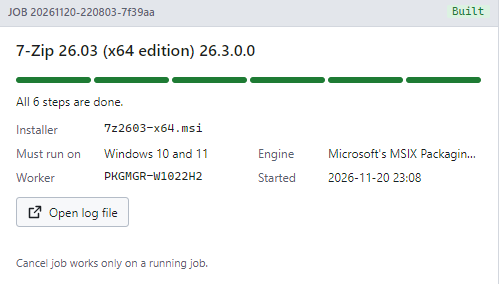
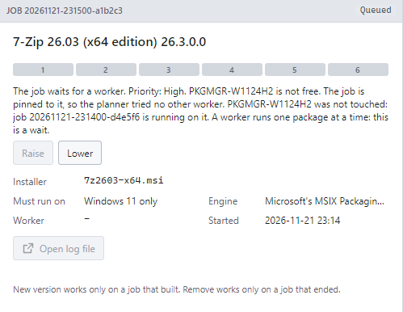
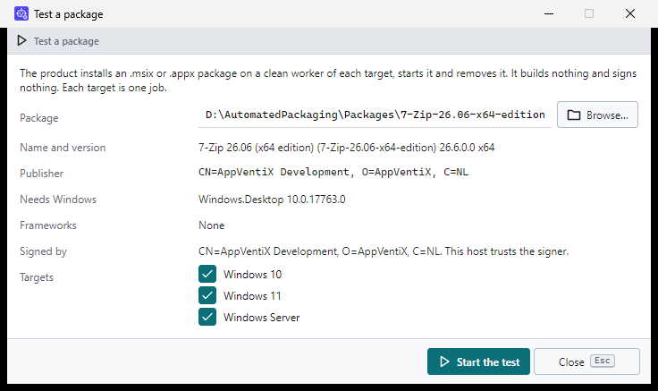
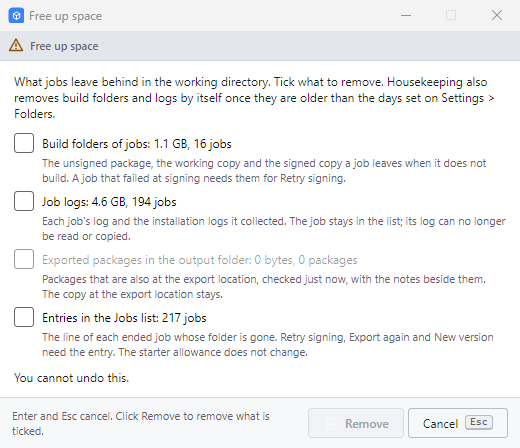
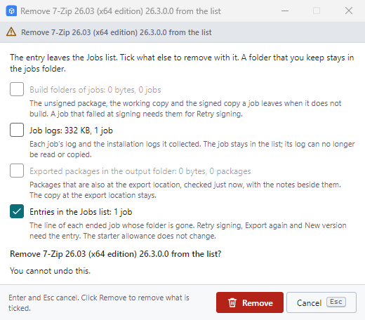

# Jobs and packages

## Follow a job

=== "GUI"

    The **Jobs** screen shows each job and its log, from the window, the command line and MCP. Select a job: its detail and its log show under the list, also while it runs.

    

    - **Open the worker's window** shows while an interactive job waits for you. The window opens by itself one time. See [Interactive installs](convert.md#interactive-installs).
    - **Cancel job** (Ctrl+K), on the toolbar of the Jobs screen, stops a running job. It asks first. The service puts the worker back to its baseline first. The job then shows Cancelled. On a job that waits in the queue, **Cancel job** takes it out of the queue. No worker is used.
    - A job that waits for a worker shows **Queued**. Its detail gives its priority, its batch and why it waits. **Raise** and **Lower** under that line change its priority.

        

    - **Copy log** and **Open log file** give you the log. The screen shows the last 2,000 lines, and 200 lines of one entry. **Open log file** shows all lines.
    - The detail of a failed job shows the failure under the step bar: the code, a headline, what to try and **Copy diagnostic**. The step bar shows the step that failed, with the number of each step in its segment.

=== "CLI"

    `convert` shows the job log while the job runs, then the result. With `--json`, it shows only one JSON object at the end. See [JSON output](command-line.md#json-output).

    The log of each job is in `<workingDir>\jobs\<job id>\job.log`. Ctrl+C asks the service to stop the job.

    `status <job-id>` shows a job: waiting, running, or how it ended. `status <job-id> --wait` waits for its end. `status <batch-id>` shows each job of a batch.

The job log tags each line `host`, `agent` or `pipeline`. The last lines give the `AP-` code and the reason of a failure.

## Notifications: the bell

The bell at the right of the top bar collects what the application has to tell you. A red bubble on the bell shows the number of new notifications. When a new one comes, the bell moves and a short message shows under it for a few seconds. The bell does not move when **Animation effects** is off in Windows (**Settings > Accessibility > Visual effects**).

Click the bell to open the list. The list shows the newest 50 notifications, the newest first. When you open the list, all its notifications are read, and the bubble goes. Press **Esc** or click outside the list to close it.

The bell collects these notifications:

- A job is complete, fails, is cancelled, or stops before its end. Click **Open in Jobs** to see the job.
- The Scheduler held a new version. It waits for your answer on the **Scheduler** screen.
- The licence expires soon or is in its grace period. Click **Licence…** to open **Settings > Licence**.
- A newer release of the Package Support Framework is available (**This host…**, **Not now**). See [Settings](settings.md).
- A newer version of the product is available (**Download page…**, **Release notes…**, **Not now**).
- What an action did, for example that a tab is not available until this host is prepared.

A notification that ends, for example after **Not now**, goes out of the list. When the licence refuses new builds, a red notice also shows above each screen until you install a licence. The message line of a screen stays on that screen.

The list is kept only while the application is open. A job that ended before the application started is not in the list: the **Jobs** screen shows it.

## Results on the Jobs screen

| Result | Meaning |
|---|---|
| **Built** | The package is built, signed and smoke-tested |
| **Built, exporting** | The package is built. The copy to the export location runs now |
| **Built, not exported** | The package is built, and the copy to the export location failed. The reason is under the facts of the job. See [Export packages](export.md) |
| Failed | The job failed. The detail of the job gives the code and what to try |
| Cancelled | Somebody stopped the job |
| Abandoned | The program that ran the job ended before the job did |

## Sign a package again

If a job fails only at signing, you can sign its package again. For example, a hardware token asked for a PIN too late.

1. Select the job on the **Jobs** screen.
2. Click **Retry signing**.

This signs the package that the job built, in seconds, with no worker. A package signed again is **not** smoke-tested, and the screen says so.

- Retry signing needs the `out\` folder of the job. Housekeeping removes it after the days set on **Settings > Folders**.
- It signs only the package that the job packed. A package that changed since then is refused with `AP-SG-011`. Build the job again.
- If the job was to export, Retry signing also exports the package.

## Sign a package for release

An AI agent can start a job while **Settings > AI agents (MCP)** is **Off**. That job signs with a test certificate that has your publisher. The product does not export its package, and shows `AP-SG-014`, also when the job did not ask for an export. **Export again** is not shown for it. See [The test certificate](mcp.md#the-test-certificate).

Before it signs, the product shows the certificate and its thumbprint, the publisher, the installer and its SHA-256, the SHA-256 of the package, and where it exports the package. It signs only the package with that SHA-256.

=== "GUI"

    1. Select the job on the **Jobs** screen.
    2. Click **Sign for release…**.
    3. Read the lines of the question. Then click **OK**, or **Cancel** to sign nothing.

=== "CLI"

    From an elevated prompt:

    ```
    AutomatedPackaging.Cli sign-for-release <job-id>
    ```

    This shows the lines and signs nothing. To sign, run it again with `--confirm`:

    ```
    AutomatedPackaging.Cli sign-for-release <job-id> --confirm
    ```

    Exit code 0 when the package is signed, 1 when it is refused or not confirmed.

    When it refuses, the reason is in `problems` and `detail` is `null`. The text output shows the reason
    one time, under "Standing in the way:". `resign` does the same.

Only one Sign for release runs for a job at a time, in the application or on the command line. A second one stops and signs nothing.

The product signs the package with the certificate that the agent named, and puts it in the output folder. Then it exports the package if the job was to export. It signs the package that the job checked before the test certificate signed it. The job keeps that package until you sign it for release, and housekeeping does not remove it.

## Select the program of a capture

A job fails with `AP-PK-005` when its capture has no application: the installer made no shortcut. When the capture has programs, the job keeps it, and the detail of `AP-PK-005` names some of them. Then select the program, and a new job starts from that capture. The new job does not run the installer. It installs the prerequisites of the earlier job on the worker, as before. It packs the capture with the program as the first application, signs it, and the start test starts that program. The earlier job gives the other settings.

=== "GUI"

    1. On the **Jobs** screen, select the job, then click **Select the program…**.
    2. A window shows the programs of the capture, in the tree of their folders. Select the program that the package starts. A folder cannot start.
    3. Click **Start the job**. A line on the Jobs screen names the new job.

=== "CLI"

    From an elevated prompt:

    ```
    AutomatedPackaging.Cli convert --from-capture <job-id> --application <path>
    ```

    Give the whole path of the program in the package, as the detail of `AP-PK-005` names it, for example `VFS\ProgramFilesX86\Contoso\Tool\tool.exe`. `check` takes `--from-capture` too. Only `--application`, `--no-application`, `--machine` and `--json` go with it.

The product refuses the new job before a worker starts when:

- The earlier job did not fail with `AP-PK-005`, or a version before this one ran it.
- The captured package is gone from the folder of the job, or it changed: `AP-PK-019`. **Free up space…** removes captured packages.
- The program is not a program of the capture, by its whole path.

The names of the programs come from the worker. The product reads them on the host, from the package itself, and lists only plain paths in the package, 500 at most.

## Build a new version of an application

When a vendor releases a new installer of an application that you packaged, start from the job that built the earlier package. The product fills in the settings of that job, and you select the new installer.

The job gives these settings: the name and the publisher, the arguments, the MSI properties and the transforms. It also gives the files beside the installer, the prerequisites, the logs, **Must run on**, the machine, the certificate and **Advanced**. The identity Name of the package stays the same, so the new package updates the earlier package. The identity comes from the earlier job, not from the name. If you change the name, the identity does not change, and a note in the box says so.

=== "GUI"

    1. On the **Jobs** screen, select a job that built a package, then click **New version…**.
    2. The Build screen opens. A note under the installer names the earlier job and its version.
    3. Select the new installer. The product fills in the settings of the earlier job.
    4. Read the notes in the box. Change what you must, then click **Build**.

    **Clear** in the note keeps what the form contains, and makes it an ordinary build.

=== "CLI"

    From an elevated prompt:

    ```
    AutomatedPackaging.Cli convert <installer> --from-job <job-id> [options]
    ```

    `check` takes `--from-job` too. Each other option that you give changes only that setting. `--machine` replaces the machine of the earlier job. When that machine cannot take the job now, a warning tells you, and the planner selects a worker.

The version:

- The product uses the version of the new installer, if it is higher than the version of the earlier job.
- If not, the product uses the version of the earlier job plus one in the last part, and a note tells you. An EXE gives no version, so this occurs for each EXE.
- The product refuses a version that is not higher than the version of the earlier job.

The product refuses the new version when:

- The earlier job did not build a package.
- The new installer is not the same type (MSI or EXE) as the earlier installer.
- A transform of the earlier job is not at its path now. Put the file back.
- A version of the product before 0.2.40 built the earlier job. That version did not record the settings of a job. Build the new version on the Build screen, and enter the settings again.

!!! warning "A different Publisher makes a different application"
    A note tells you when this host does not have the certificate of the earlier job. A package with a different publisher does not update the earlier package.

## Re-sign a package

You can sign an `.msix` or `.appx` file that the product did not build. For example, a package from a vendor, or a package that an earlier tool made. The Publisher of the package becomes the subject of the certificate.

!!! warning "A different Publisher makes a different application"
    Windows does not update an installed copy of the old package with the re-signed package. The product warns when the Publisher changes.

=== "GUI"

    1. On the **Jobs** screen, click **More…**, then **Re-sign a package…**. With no jobs, a **Re-sign a package…** button is also in the empty job list.
    2. Click **Browse…** and select the package. **Publisher now** shows its Publisher. **Capabilities**, **Extensions**, **Signed before by** and **SHA-256** show what your certificate will vouch for.
    3. Select the certificate in **Certificate**. **Publisher after** shows the Publisher that the package gets.
    4. To change the version, type it in **Version**. Leave it empty to keep the version.
    5. Click **Re-sign**.

=== "CLI"

    From an elevated prompt:

    ```
    AutomatedPackaging.Cli resign <package> [--certificate-thumbprint <thumbprint> | --signing-profile <id>] [--package-version <version>] [--json]
    ```

    The certificate is selected as for `convert`. Exit code 0 when the package is signed, 1 when it is refused.

    The output gives the lines `Capabilities`, `Extensions`, `Signed before by` and `SHA-256`. With `--json`, they are in `packageFacts`.

Before you sign, read what the package asks for:

| Line | What it tells you |
|---|---|
| **Capabilities** | What the package may do, for example `runFullTrust` or `allowElevation` |
| **Extensions** | What the package adds to Windows, for example `windows.service` or `windows.firewallRules` |
| **Signed before by** | `none`, `this host` (a certificate with its key in this computer's store), or `unknown`. The old subject is in quotes |
| **SHA-256** | The hash of the file. The product signs only a file with this hash. If the file changes, select it again |

The product works on a copy of the package. It removes the old signature and catalog, packs the package again, signs it, and reads it back. The name, version, Publisher and signer must agree, or the product does not keep the package.

The signed package goes to the output folder, with a `.notes.txt` file. It names the old and the new Publisher and signer, the capabilities, the extensions and the SHA-256 before. The product never replaces a package in the output folder: a second package gets `_2` in its name. It does not export the package, and it does not smoke-test it. Install and start the package one time before you use it.

The product refuses a bundle file (`.msixbundle` or `.appxbundle`): re-sign each package in it. It also refuses a test certificate for AI agents, and a package that needs more free space than the drive of the working directory has. It refuses a package whose name or version the MSIX format does not allow. A name has 3 to 50 letters, digits, dots or hyphens.

## Test a package

A test installs an `.msix` or `.appx` file on a clean worker, starts it and removes it. The product builds nothing and signs nothing. Test a package of a vendor before you give it to users. Or test a package of this product again after Windows updates on the workers.

=== "GUI"

    1. On the **Jobs** screen, click **More…**, then **Test a package…**. To test the package of a job that built, select the job, then click **More…** and **Test the package again**.
    2. Click **Browse…** and select the package. The window shows its name and version, its Publisher, the Windows version that it needs, the frameworks that it needs and who signed it.
    3. Under **Targets**, select Windows 10, Windows 11 or Windows Server. Each target is one job. A target that the package cannot run on shows **Not for this target** and the reason. A target with no worker on this host is not available.
    4. Click **Start the test**. The jobs go into the queue as one batch. A job that passed reads **Test passed**.

    

=== "CLI"

    From an elevated prompt:

    ```
    AutomatedPackaging.Cli test <package> [--target windows10,windows11,server] [--priority <p>] [--no-wait] [--json]
    ```

    Without `--target`, the test runs on each target that has a worker on this host. A target that the package cannot run on gets no job: the command writes **Not for this target** and the reason. When the jobs end, it writes one line for each target: the job, and `passed` or the code that it failed with.

What the job does:

- It reverts the worker to its baseline, as every job does. The agent of the worker must be of version 0.2.71 or later. A worker with an older agent gets no test (`AP-IM-030`): update the worker.
- It installs the frameworks that the package needs, for example VCLibs or the Windows App Runtime. It takes each one from the Prerequisites library, type **Framework package (MSIX)** (see [A framework package (MSIX)](prerequisites.md#a-framework-package-msix)). When the library has no item for a framework, the test does not start (`AP-PK-024`). The message names the framework, its lowest version, its architecture, its publisher and its WinGet ID.
- It trusts the certificate that signed the package, on the worker only. The revert at the end of the job removes this trust.
- It installs the package, starts its first application, and removes it. A package with no application is installed and removed.
- It builds no package. The starter allowance does not limit tests. A licence that is not valid, for example an expired licence, refuses a test as it refuses a build.

The product refuses a file that is not an `.msix` or `.appx` package (`AP-PK-022`), and a bundle. It refuses a package with no signature, or with a file that changed after it was signed (`AP-PK-023`). A signer that this host does not trust is not refused: the job log warns. When no target that you selected is left, the test does not start (`AP-PK-025`).

On the **Jobs** screen, a test reads **Test:** before its name. Its steps 3, 4 and 5 are **Skipped**, and its engine is **None**.

## The right-click menu of a list

Right-click a row of the **Scheduler**, **Jobs**, **Workers**, **OS media** or **Prerequisites** list. A menu opens with the actions of the buttons for that row. Each item does the same as its button, and asks the same questions. An item is not available when its button is not available. The tooltip of the item then tells why, where the button has a tooltip.

The right click selects the row first, because most buttons act on the selected row. A worker has no selection: the menu acts on the worker that you right-clicked.

Under the actions are **Copy name** and **Copy ID**, where the row has them. On the **Scheduler**, they are **Copy package ID** and **Copy item ID**. A prerequisite also has **Copy SHA-256**. Where a row can be removed, the remove item is the last item.

To open the menu with the keyboard, select the row. Then press the Menu key or Shift+F10. The command line has no lists, so this is for the window only.

| List | Items |
|---|---|
| Scheduler | Check now, Edit, Build again, Take over (an AI agent's item), Accept and Reject (a held version), Copy package ID, Copy item ID, Remove |
| Jobs | Cancel job, New version…, Raise, Lower, Retry signing, Select the program, Open the worker's window, Export again, Sign for release, Open log file, Test the package again, Save as recipe…, Copy name, Copy ID, Remove… |
| Workers | Build again, Update, Revert, Pause or Resume, Retire, Copy name, Remove… |
| OS media | Scan and prepare…, Open drop folder, Copy name |
| Prerequisites | Update to…, Download, Edit…, New version…, Copy name, Copy ID, Copy SHA-256, Remove… |

A Jobs item shows only where its button shows for that job, as in the job's panel.

## After a crash

If the application, the service or the host stopped during a job, the **Jobs** screen shows a panel at the next start. For each job or worker operation that did not end:

- **Revert worker** puts the worker back to its baseline. It asks first: the state kept for diagnosis is lost, and you cannot undo it. If the revert fails, the panel says why, and the worker stays kept. It takes no jobs until a revert succeeds.
- **Keep for diagnosis** keeps the worker as it is. A kept worker takes no jobs until you revert it.

Nothing is reverted without your decision, because the worker is the evidence.

When the service stops, it cancels its jobs and puts their workers back. A job that has not ended after three minutes shows Abandoned at the next start of the service.

## Housekeeping

The application removes the files that jobs leave. It does this when it starts, and once a day while it is open. Set the days on **Settings > Folders**, under **Housekeeping**, then click **Save housekeeping**. Each value is 1 to 365 days.

| Setting | Default | What is removed after the days |
|---|---|---|
| **Build folders of a failed job** | 14 days | `captured\`, `work\` and `out\` of a job that failed, was cancelled or was abandoned. The logs stay |
| **Job logs** | 30 days | All other files in the folder of the job, then the folder. The job stays on the Jobs screen |

A job that built removes its build folders itself. A job that runs or waits is never touched.

While `host.json` cannot be used as written, housekeeping removes nothing. The application log says why.

## Free up space

**Free up space…**, on the toolbar of the **Jobs** screen, removes files sooner, of any age. It opens a window, which measures each kind:



- **Build folders of jobs**: the three build folders of each job that still has them.
- **Job logs**: the logs of each job that ended.
- **Exported packages in the output folder**: a package in `<workingDir>\Packages\` that its job exported. The product removes it only when it is the same file that was exported, and the copy is still at the export location.
- **Entries in the Jobs list**: the line of each ended job whose folder is no longer in the jobs folder. **Retry signing**, **Export again** and **New version…** need the entry. Removing entries does not change the starter allowance: each package that a job built still counts.

1. Tick what to remove.
2. Read the window. It names the amount, for example "Remove 1.2 GB from this host?", and what it is.
3. Click **Remove**. **Cancel**, Enter or Esc removes nothing.

The message above the status bar then says how much it removed, and names each item that it kept. You cannot get back what it removed.

**Remove one job from the list.** Select a job and click **Remove…** (Delete) on the toolbar. Or right-click a job in the list and click **Remove…**. The same window opens for that job only, with its entry ticked. Tick what else goes with the entry: its build folders, its logs, and its exported package in the output folder. Then click **Remove**. A file that you do not tick stays in the jobs folder. **Remove…** is not available for a job that still runs, waits or copies its package.



## What the notes of a package say

Beside each package, the job writes `<package>.notes.txt` and `<package>.PackageInfo.json`. They give:

- the application, vendor and version,
- the file name and SHA-256 of the installer,
- **the arguments of the installer, as given**. If an argument holds a licence key or a password, the notes hold it too,
- each prerequisite, with what a target machine needs,
- the certificate that signed the package.
