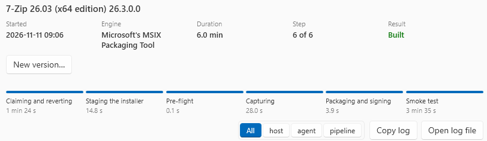

# Jobs and packages

## Follow a job

=== "GUI"

    The **Jobs** screen shows each job and its log, from the window, the command line and MCP. Select a job to see its facts and its log while it runs.

    

    - **Open the worker's window** shows while an interactive job waits for you. The window opens by itself one time. See [Interactive installs](convert.md#interactive-installs).
    - **Cancel job**, under the facts of a running job, stops it. The service puts the worker back to its baseline first. The job then shows Cancelled.
    - **Copy log** and **Open log file** give you the log.
    - A failed job shows a failure card above its log: the code, the step, a headline, **What to try** and **Copy diagnostic**.

=== "CLI"

    `convert` shows the job log while the job runs, then the result. With `--json`, it shows only one JSON object at the end. See [JSON output](command-line.md#json-output).

    The log of each job is in `<workingDir>\jobs\<job id>\job.log`. Ctrl+C asks the service to stop the job.

The job log tags each line `host`, `agent` or `pipeline`. The last lines give the `AP-` code and the reason of a failure.

## Results on the Jobs screen

| Result | Meaning |
|---|---|
| **Built** | The package is built, signed and smoke-tested |
| **Built, exporting** | The package is built. The copy to the export location runs now |
| **Built, not exported** | The package is built, and the copy to the export location failed. The reason is under the facts of the job. See [Export packages](export.md) |
| Failed | The job failed. The failure card gives the code and what to try |
| Cancelled | Somebody stopped the job |
| Abandoned | The program that ran the job ended before the job did |

## Sign a package again

If a job fails only at signing, you can sign its package again. For example, a hardware token asked for a PIN too late.

1. Select the job on the **Jobs** screen.
2. Click **Retry signing**.

This signs the package that the job built, in seconds, with no worker. A package signed again is **not** smoke-tested, and the screen says so.

- Retry signing needs the `out\` folder of the job. Housekeeping removes it after the days set on **Settings > Folders**.
- It signs only the package that the job packed. A package that changed since then is refused with `AP-SG-011`. Build the job again.
- If the job was to export, Retry signing also exports the package.

## Sign a package for release

An AI agent can start a job while **Settings > AI agents (MCP)** is **Off**. That job signs with a test certificate that has your publisher. The product does not export its package, and shows `AP-SG-014`, also when the job did not ask for an export. **Export again** is not shown for it. See [The test certificate](mcp.md#the-test-certificate).

Before it signs, the product shows the certificate and its thumbprint, the publisher, the installer and its SHA-256, the SHA-256 of the package, and where it exports the package. It signs only the package with that SHA-256.

=== "GUI"

    1. Select the job on the **Jobs** screen.
    2. Click **Sign for release**.
    3. Read the lines that the screen shows. Then click **Sign**, or **Cancel** to sign nothing.

=== "CLI"

    From an elevated prompt:

    ```
    AutomatedPackaging.Cli sign-for-release <job-id>
    ```

    This shows the lines and signs nothing. To sign, run it again with `--confirm`:

    ```
    AutomatedPackaging.Cli sign-for-release <job-id> --confirm
    ```

    Exit code 0 when the package is signed, 1 when it is refused or not confirmed.

Only one Sign for release runs for a job at a time, in the application or on the command line. A second one stops and signs nothing.

The product signs the package with the certificate that the agent named, and puts it in the output folder. Then it exports the package if the job was to export. It signs the package that the job checked before the test certificate signed it. The job keeps that package until you sign it for release, and housekeeping does not remove it.

## Build a new version of an application

When a vendor releases a new installer of an application that you packaged, start from the job that built the earlier package. The product fills in the settings of that job, and you select the new installer.

The job gives these settings: the name and the publisher, the arguments, the MSI properties and the transforms. It also gives the files beside the installer, the prerequisites, the logs, **Must run on**, the machine, the certificate and **Advanced**. The identity Name of the package stays the same, so the new package updates the earlier package.

=== "GUI"

    1. On the **Jobs** screen, select a job that built a package, then click **New version…**.
    2. The Build screen opens. A note above the installer names the earlier job and its version.
    3. Select the new installer. The product fills in the settings of the earlier job.
    4. Read the notes in the box. Change what you must, then click **Build**.

    **Clear** in the note keeps what the form contains, and makes it an ordinary build.

=== "CLI"

    From an elevated prompt:

    ```
    AutomatedPackaging.Cli convert <installer> --from-job <job-id> [options]
    ```

    `check` takes `--from-job` too. Each other option that you give changes only that setting. `--machine` replaces the machine of the earlier job. When that machine cannot take the job now, a warning tells you, and the planner selects a worker.

The version:

- The product uses the version of the new installer, if it is higher than the version of the earlier job.
- If not, the product uses the version of the earlier job plus one in the last part, and a note tells you. An EXE gives no version, so this occurs for each EXE.
- The product refuses a version that is not higher than the version of the earlier job.

The product refuses the new version when:

- The earlier job did not build a package.
- The new installer is not the same type (MSI or EXE) as the earlier installer.
- A transform of the earlier job is not at its path now. Put the file back.
- A version of the product before 0.2.40 built the earlier job. That version did not record the settings of a job. Build the new version on the Build screen, and enter the settings again.

!!! warning "A different Publisher makes a different application"
    A note tells you when this host does not have the certificate of the earlier job. A package with a different publisher does not update the earlier package.

## Re-sign a package

You can sign an `.msix` or `.appx` file that the product did not build. For example, a package from a vendor, or a package that an earlier tool made. The Publisher of the package becomes the subject of the certificate.

!!! warning "A different Publisher makes a different application"
    Windows does not update an installed copy of the old package with the re-signed package. The product warns when the Publisher changes.

=== "GUI"

    1. On the **Jobs** screen, click **Re-sign a package…**. With no jobs, the button is in the middle of the screen.
    2. Click **Browse…** and select the package. **Publisher now** shows its Publisher. **Capabilities**, **Extensions**, **Signed before by** and **SHA-256** show what your certificate will vouch for.
    3. Select the certificate in **Certificate**. **Publisher after** shows the Publisher that the package gets.
    4. To change the version, type it in **Version**. Leave it empty to keep the version.
    5. Click **Re-sign**.

=== "CLI"

    From an elevated prompt:

    ```
    AutomatedPackaging.Cli resign <package> [--certificate-thumbprint <thumbprint> | --signing-profile <id>] [--package-version <version>] [--json]
    ```

    The certificate is selected as for `convert`. Exit code 0 when the package is signed, 1 when it is refused.

    The output gives the lines `Capabilities`, `Extensions`, `Signed before by` and `SHA-256`. With `--json`, they are in `packageFacts`.

Before you sign, read what the package asks for:

| Line | What it tells you |
|---|---|
| **Capabilities** | What the package may do, for example `runFullTrust` or `allowElevation` |
| **Extensions** | What the package adds to Windows, for example `windows.service` or `windows.firewallRules` |
| **Signed before by** | `none`, `this host` (a certificate with its key in this computer's store), or `unknown`. The old subject is in quotes |
| **SHA-256** | The hash of the file. The product signs only a file with this hash. If the file changes, select it again |

The product works on a copy of the package. It removes the old signature and catalog, packs the package again, signs it, and reads it back. The name, version, Publisher and signer must agree, or the product does not keep the package.

The signed package goes to the output folder, with a `.notes.txt` file. It names the old and the new Publisher and signer, the capabilities, the extensions and the SHA-256 before. The product never replaces a package in the output folder: a second package gets `_2` in its name. It does not export the package, and it does not smoke-test it. Install and start the package one time before you use it.

The product refuses a bundle file (`.msixbundle` or `.appxbundle`): re-sign each package in it. It also refuses a test certificate for AI agents, and a package that needs more free space than the drive of the working directory has. It refuses a package whose name or version the MSIX format does not allow. A name has 3 to 50 letters, digits, dots or hyphens.

## After a crash

If the application, the service or the host stopped during a job, the **Jobs** screen shows a panel at the next start. For each job or worker operation that did not end:

- **Revert worker** puts the worker back to its baseline.
- **Keep for diagnosis** keeps the worker as it is. A kept worker takes no jobs until you revert it.

Nothing is reverted without your decision, because the worker is the evidence.

When the service stops, it cancels its jobs and puts their workers back. A job that has not ended after three minutes shows Abandoned at the next start of the service.

## Housekeeping

The application removes the files that jobs leave. It does this when it starts, and once a day while it is open. Set the days on **Settings > Folders**, under **Housekeeping**, then click **Save housekeeping**. Each value is 1 to 365 days.

| Setting | Default | What is removed after the days |
|---|---|---|
| **A failed job's build folders, kept for** | 14 days | `captured\`, `work\` and `out\` of a job that failed, was cancelled or was abandoned. The logs stay |
| **Job logs, kept for** | 30 days | All other files in the folder of the job, then the folder. The job stays on the Jobs screen |

A job that built removes its build folders itself. A job that runs or waits is never touched.

While `host.json` cannot be used as written, housekeeping removes nothing. The application log says why.

## Free up space

**Free up space…**, under the job list on the **Jobs** screen, removes files sooner, of any age. It measures each kind when it opens:

- **Build folders of jobs**: the three build folders of each job that still has them.
- **Job logs**: the logs of each job that ended.
- **Exported packages in the output folder**: a package in `<workingDir>\Packages\` that its job exported. The product removes it only when it is the same file that was exported, and the copy is still at the export location.

1. Tick what to remove.
2. Click **Remove ticked…**.
3. Read the confirmation. It gives the size, for example "Remove 1.2 GB from this host?".
4. Click **Remove**.

The screen then says how much it removed, and names each item that it kept. You cannot get back what it removed.

## What the notes of a package say

Beside each package, the job writes `<package>.notes.txt` and `<package>.PackageInfo.json`. They give:

- the application, vendor and version,
- the file name and SHA-256 of the installer,
- **the arguments of the installer, as given**. If an argument holds a licence key or a password, the notes hold it too,
- each prerequisite, with what a target machine needs,
- the certificate that signed the package.
