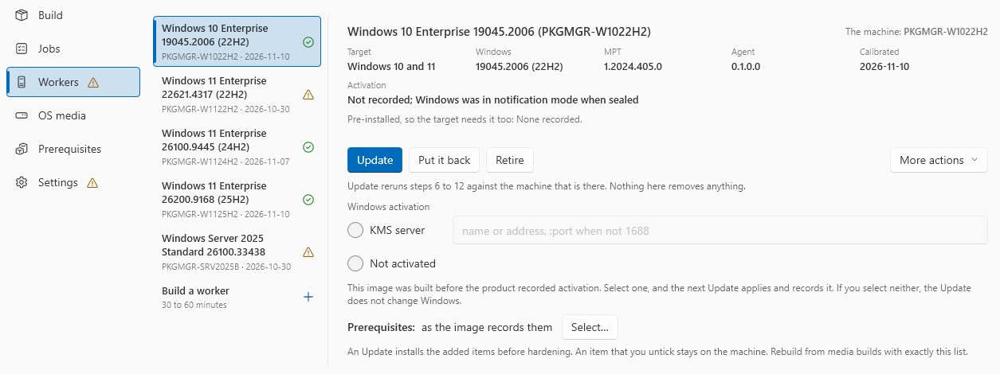

# Keep images current

Select an image on the **Workers** screen. Its actions are on the card under its facts. **Update**, **Put it back** and **Retire** are buttons. **Rebuild from media…**, **Remove the machine…** and **Forget this image record** are in the **More actions** menu.

| Action | Window | Command line |
|---|---|---|
| Update | **Update** | `worker update` |
| Put it back | **Put it back** | Not available |
| Retire | **Retire** | Not available |
| Rebuild from media | **Rebuild from media…** | Not available |
| Remove the machine | **Remove the machine…** | `worker remove` |
| Forget the image record | **Forget** | `image forget` |

The command line acts on workers by name. Run it from an elevated prompt, with the application window closed. To list the workers:

```
AutomatedPackaging.Cli machines
```

## Update

An update runs steps 6 to 12 again on the existing machine, and writes the image record again. It does not install Windows or the packaging tool again.

- Update after you install a newer build of the product. The worker then gets the new agent.
- For a KMS image, an update activates Windows again. This renews the activation.
- An update keeps the address of the worker on the internal switch.
- An update installs prerequisites that you added to the image. It cannot remove a prerequisite.

=== "GUI"

    1. Select the image.
    2. Optional: change the KMS server or the prerequisites on the card.
    3. Click **Update**.

    

=== "CLI"

    ```
    AutomatedPackaging.Cli worker update PKGMGR-001
    AutomatedPackaging.Cli worker update PKGMGR-001 --kms-server kms2.example.com
    ```

    `--kms-server` changes the KMS server of a KMS image. `--activation` gives a method to an image that recorded none. The steps that an update does not run show as `skipped`.

!!! warning "An update seals the machine as it is"
    An update makes the current disk the new baseline. Do not experiment in a worker before you update it. If you did, use **Rebuild from media** instead.

## When an image is behind

The product compares each image with this version of the product and with the settings of this host. An image that is behind shows a mark on its row, and the same mark shows after **Workers** in the menu. Select the image to see each reason and its remedy.

| Mark | What it means for jobs |
|---|---|
| **Update required** (red) | The product does not start a job on the image. When another image for the target is current, the job goes to that image. Otherwise the job stops with `AP-IM-023` |
| **Update recommended** (orange) | Jobs still run. An update gives the image something better |

| Reason | Mark | Remedy |
|---|---|---|
| The agent in the image is older than 0.2.14 | Red | **Update** |
| The agent in the image does not have a feature of this version of the product. The reason names each feature: "Update this worker to use: …" | Orange | **Update** |
| A worker of the image connects to a different address or port than the listener of this host | Red | **Update** |
| The channel authority that signed the certificate of the worker is no longer trusted | Red | **Update** |
| An earlier channel authority signed the certificate of the worker, during a change of authority | Orange | **Update** |
| The packaging account of the worker is not the account of the image | Red | **Rebuild from media** |
| The exclusion set does not leave out the cache of Windows Installer | Orange | **Update** |
| The image was calibrated 180 days ago or more | Orange | **Update** |

A development build of the product counts as current. An older image does not record its channel authority, so the product does not judge it. The next update of the image records it.

Each feature that needs the agent names the agent version that brought it. These features need the agent in the worker:

- the built-in engine, restarts in a built-in capture, and the trace of the installer
- interactive installs, and restarts in an interactive built-in capture
- the MakeAppx error in a failed job, and the check that PSF fixups loaded

An image with an older agent reads **Update recommended**, and its reason lists the features that it does not have. When a job uses one of these features, the product does not give the job to that image. It gives the job to another image for the target whose agent has the feature. If no image has it, the job stops with `AP-IM-030` before it touches a worker. A job pinned to a worker of that image stops too. The Build screen, `check` and the MCP tool `check_job` show this before you start the job.

The built-in engine, its restarts and the trace apply to a job on the built-in engine. Interactive installs apply to an interactive job, and their restarts to an interactive job on the built-in engine. The MakeAppx error and the PSF check never stop a job: without them, the job runs as before.

## Put it back

**Put it back** reverts the worker to its `baseline` checkpoint, and releases a hold on it. If Hyper-V has no machine of that name, it says so. Then use **Remove the machine…** to forget the worker.

## Retire

**Retire** reverts the worker and marks it retired. A retired worker gets no jobs. The machine stays until you remove it. You cannot undo Retire. When you need the worker again, build a new one.

## Rebuild from media

**Rebuild from media…** deletes the machine and its disks. It then runs all twelve steps again, from the same media and edition.

- The product checks the host, the media and the edition before it deletes anything.
- A rebuild that would install a different edition is refused.
- The old image record goes only when the new worker is recorded.

You cannot undo a rebuild.

## Remove the machine

Removing deletes the machine and its disks, and forgets the worker. If no other worker is built from the image, the image record goes too. You cannot undo a removal.

=== "GUI"

    1. Select the image.
    2. In **More actions**, select **Remove the machine…**.
    3. Read the confirmation. It names the machine, says what goes, and says if jobs for the target can still run.
    4. Click the button of the confirmation. **Cancel** or **Esc** goes back.

    A row marked **password only** is a stored packaging-account password with no worker and no machine. An older build left it. **Remove...** deletes only that password. The product keeps it when a worker has the name, a build holds the name, or a virtual machine has the name. It also keeps it when Hyper-V does not answer.

=== "CLI"

    ```
    AutomatedPackaging.Cli worker remove PKGMGR-001
    AutomatedPackaging.Cli worker remove PKGMGR-001 --confirm
    ```

    Without `--confirm`, the command says what the confirmation on the screen says, and removes nothing. It exits with code 1.

    For a **password only** row, `worker remove <name> --confirm` then deletes only that password. It refuses when a worker or a virtual machine has the name, or when Hyper-V does not answer.

If Hyper-V has no machine of that name, the product deletes nothing and only forgets the worker. If the delete fails, the worker is marked retired, so it gets no jobs.

## Forget an image record

Forget removes an image record that no worker uses. It touches no machine.

=== "GUI"

    Select the image, then **Forget this image record** in **More actions**. When it is the only action left, **Forget** is a button on the card.

=== "CLI"

    ```
    AutomatedPackaging.Cli image forget img-0123456789ab
    ```

    The command is refused while a worker is built from the image. Remove the worker instead.

## Replace the channel authority

The channel authority is the private certificate authority of this host. It issues the certificate of the listener and one certificate for each worker. Its private key cannot be exported, so you cannot back it up or move it. When the authority is lost, you make a new one and give each worker a new certificate.

### A new host, or a host that you install again

The workers do not move to a different host. Their passwords are encrypted for this computer only.

1. Install the product and run host preparation. Page 7 creates a new authority. Host preparation also issues the certificate of the listener and writes `agent-channel.json`.
2. Stage the media again. See [Stage media](stage-media.md).
3. Build each worker again on the Workers screen. See [Build a worker image](build-image.md).

### The same host: the authority is lost or must be replaced

Do this when host preparation says "This host has no channel authority", or when somebody could have a copy of the key. Run no job until the last step is done.

1. If the old authority is still there and you replace it, remove it. Open `certlm.msc`, **Personal > Certificates**. Delete the certificate with the friendly name **Automated Packaging channel authority**.
2. Open `<dataFolder>\agent-channel.json`. Remove the value of `serverCertificateThumbprint`: the certificate of the listener comes from the old authority.
3. Run host preparation, and apply the changes. It creates a new authority and puts it first in `trustedAuthorityThumbprints`. It keeps the old thumbprints, and issues a new certificate for the listener.
4. Restart the service **AppVentiX Automated Packaging**.
5. Click **Update** for each worker on the Workers screen. Step 6 gives the worker a certificate from the new authority. If an update fails, use **Rebuild from media**.
6. In `agent-channel.json`, remove each old thumbprint from `trustedAuthorityThumbprints`. Keep the first one. Then run host preparation again, and restart the service.

After step 3, the Workers screen marks each worker that is not updated. After step 6, such a worker reads **Update required**, and the product starts no job on it.

## Good to know

- **No action takes a worker from a running job.** These actions refuse a worker that something else holds, and name the holder.
- **While an action runs, the image list is locked.** The result stays on the card until you select another image.
- **Closing the window asks first** during a scan, a build, an update, a rebuild, a put back, a retire or a removal. A job continues when the window closes.
- **The managed prefix can change.** Earlier prefixes stay managed, so you can still see and remove the old workers.
- The Workers screen acts on the first worker of each image. A second worker of the same image is refused on the command line.
