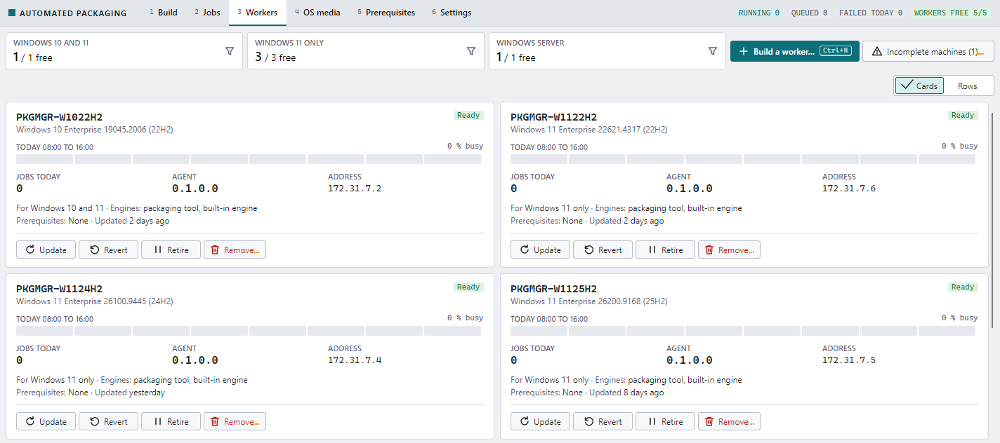

# Keep images current

Each image has a card on the **Workers** screen. **Update**, **Revert**, **Pause** (or **Resume**), **Retire** and **Remove…** are buttons on the card. **Update** opens the Update window, with the facts of the image and the options of the update. **Rebuild from media…** is in the Update window. For an image with no machine, **Forget** is in the Update window in place of **Update**.

| Action | Window | Command line |
|---|---|---|
| Update | **Update** | `worker update` |
| Revert | **Revert** | Not available |
| Pause and resume | **Pause**, **Resume** | `worker pause`, `worker resume` |
| Retire | **Retire** | Not available |
| Rebuild from media | **Rebuild from media…** | Not available |
| Remove the machine | **Remove…** | `worker remove` |
| Forget the image record | **Forget** | `image forget` |

The command line acts on workers by name. Run it from an elevated prompt, with the application window closed. To list the workers:

```
AutomatedPackaging.Cli machines
```

## Update

An update runs steps 7 to 13 again on the existing machine, and writes the image record again. It does not install Windows or the packaging tool again. When the host proxy is on, step 4 first installs the Windows updates of the worker, and then updates Microsoft Edge and the WebView2 Runtime. See [Windows updates in an Update](worker-internet.md#windows-updates-in-an-update).

- Update after you install a newer build of the product. The worker then gets the new agent.
- For a KMS image, an update activates Windows again. This renews the activation.
- An update keeps the address of the worker on the internal switch.
- An update installs prerequisites that you added to the image. It cannot remove a prerequisite.

=== "GUI"

    1. On the **Workers** screen, click **Update** on the card of the worker. The Update window opens.
    2. Optional: change the KMS server or the prerequisites in the window.
    3. Click **Update** in the window. The window shows the steps, and **Stop** stops the update.

    

=== "CLI"

    ```
    AutomatedPackaging.Cli worker update PKGMGR-001
    AutomatedPackaging.Cli worker update PKGMGR-001 --kms-server kms2.example.com
    ```

    `--kms-server` changes the KMS server of a KMS image. `--activation` gives a method to an image that recorded none. The steps that an update does not run show as `skipped`.

!!! warning "An update seals the machine as it is"
    An update makes the current disk the new baseline. Do not experiment in a worker before you update it. If you did, use **Rebuild from media…** instead.

## When an image is behind

The product compares each image with this version of the product and with the settings of this host. An image that is behind shows a warning line for each reason on its card, and a mark shows on the **Workers** tab. Click **Update** on the card: the Update window lists each reason with its remedy.

| Mark | What it means for jobs |
|---|---|
| **Update required** (red) | The product does not start a job on the image. When another image for the target is current, the job goes to that image. Otherwise the job stops with `AP-IM-023` |
| **Update recommended** (orange) | Jobs still run. An update gives the image something better |

| Reason | Mark | Remedy |
|---|---|---|
| The agent in the image is older than 0.2.14 | Red | **Update** |
| The agent in the image does not have a feature of this version of the product. The reason names each feature: "Update this worker to use: …" | Orange | **Update** |
| A worker of the image connects to a different address or port than the listener of this host | Red | **Update** |
| The channel authority that signed the certificate of the worker is no longer trusted | Red | **Update** |
| An earlier channel authority, which is still trusted, signed the certificate of the worker. The agent in the worker does not trust the current authority | Red | **Update** |
| The image does not record its channel authority, and its last update was before this host made its current authority | Red | **Update** |
| The packaging account of the worker is not the account of the image | Red | **Rebuild from media…** |
| The exclusion set does not leave out the cache of Windows Installer | Orange | **Update** |
| The image was calibrated 180 days ago or more | Orange | **Update** |

A development build of the product counts as current. An older image does not record its channel authority. For such an image, the product compares the date of its last update with the date of the current authority of this host. The next update of the image records the authority.

Each feature that needs the agent names the agent version that brought it. These features need the agent in the worker:

- the built-in engine, restarts in a built-in capture, and the trace of the installer
- interactive installs, and restarts in an interactive built-in capture
- the MakeAppx error in a failed job, and the check that PSF fixups loaded

An image with an older agent reads **Update recommended**, and its reason lists the features that it does not have. When a job uses one of these features, the product does not give the job to that image. It gives the job to another image for the target whose agent has the feature. If no image has it, the job stops with `AP-IM-030` before it touches a worker. When the images for the target are passed over for different reasons, the message gives each code, for example `AP-IM-023` and `AP-IM-030`. A job pinned to a worker of that image stops too. The Build screen, `check` and the MCP tool `check_job` show this before you start the job.

The built-in engine, its restarts and the trace apply to a job on the built-in engine. Interactive installs apply to an interactive job, and their restarts to an interactive job on the built-in engine. The MakeAppx error and the PSF check never stop a job: without them, the job runs as before.

## Revert

**Revert** reverts the worker to its `baseline` checkpoint, and releases a hold on it. If Hyper-V has no machine of that name, it says so. Then use **Remove…** to forget the worker.

## Pause a worker

**Pause** puts a worker in maintenance mode. The job planner gives it no new job until you resume it. Pause changes nothing on the machine, and you can undo it.

- A job that runs on the worker continues to its end. The chip shows **Busy** until then, and **Paused** after.
- **Update**, **Revert**, **Retire**, **Rebuild from media…** and **Remove…** stay available.
- A job for the target goes to another free worker. When no other worker is free, the job waits in the queue. It starts when you resume the worker.
- The worker stays paused when the product or the host starts again, and after an update or a revert. A rebuild or a removal ends the pause.
- An AI agent sees a paused worker in `list_machines`. No MCP tool can pause or resume a worker.

=== "GUI"

    1. On the **Workers** screen, click **Pause** on the card of the worker. The chip shows **Paused**, and a line on the card tells that the worker gets no new job.
    2. To give the worker jobs again, click **Resume** on the card.

=== "CLI"

    ```
    AutomatedPackaging.Cli worker pause PKGMGR-001
    AutomatedPackaging.Cli worker resume PKGMGR-001
    ```

    `machines` shows a paused worker as `paused`. A pause of a retired worker is refused.

## Retire

**Retire** reverts the worker and marks it retired. A retired worker gets no jobs. The machine stays until you remove it. You cannot undo Retire. When you need the worker again, build a new one.

## Rebuild from media

**Rebuild from media…** deletes the machine and its disks. It then runs all twelve steps again, from the same media and edition.

- The product checks the host, the media and the edition before it deletes anything.
- A rebuild that would install a different edition is refused.
- The old image record goes only when the new worker is recorded.

Click **Update** on the card of the worker, then **Rebuild from media…** in the Update window. A question names the machine and tells what goes. Click **OK** to go on. You cannot undo a rebuild.

## Remove the machine

Removing deletes the machine and its disks, and forgets the worker. If no other worker is built from the image, the image record goes too. You cannot undo a removal.

=== "GUI"

    1. On the **Workers** screen, click **Remove…** on the card of the worker.
    2. Read the question. It names the machine, says what goes, and says if jobs for the target can still run.
    3. Click **OK** to go on. **Cancel**, Enter or Esc changes nothing.

    **Incomplete machines…** on the **Workers** screen opens a window with the machines that no image includes. A row marked **password only** there is a stored packaging-account password with no worker and no machine. An older build left it. **Remove** in its row deletes only that password. The product keeps it when a worker has the name, a build holds the name, or a virtual machine has the name. It also keeps it when Hyper-V does not answer.

=== "CLI"

    ```
    AutomatedPackaging.Cli worker remove PKGMGR-001
    AutomatedPackaging.Cli worker remove PKGMGR-001 --confirm
    ```

    Without `--confirm`, the command says what the question in the window says, and removes nothing. It exits with code 1.

    For a **password only** row, `worker remove <name> --confirm` then deletes only that password. It refuses when a worker or a virtual machine has the name, or when Hyper-V does not answer.

If Hyper-V has no machine of that name, the product deletes nothing and only forgets the worker. If the delete fails, the worker is marked retired, so it gets no jobs.

## Forget an image record

Forget removes an image record that no worker uses. It touches no machine.

=== "GUI"

    Click **Update** on the card of the image. For an image with no registered machine, the Update window shows **Forget** in place of **Update**. Click **Forget**.

=== "CLI"

    ```
    AutomatedPackaging.Cli image forget img-0123456789ab
    ```

    The command is refused while a worker is built from the image. Remove the worker instead.

## Replace the channel authority

The channel authority is the private certificate authority of this host. It issues the certificate of the listener and one certificate for each worker. Its private key cannot be exported, so you cannot back it up or move it. When the authority is lost, you make a new one and give each worker a new certificate.

### A new host, or a host that you install again

The workers do not move to a different host. Their passwords are encrypted for this computer only.

1. Install the product and run host preparation. Page 7 creates a new authority. Host preparation also issues the certificate of the listener and writes `agent-channel.json`.
2. Stage the media again. See [Stage media](stage-media.md).
3. Restore a backup of the old host. The restore keeps each worker aside with its build settings. See [Back up, restore and move](backup-restore.md#move-to-a-new-host).
4. Build each worker again: click **Build again** on its card on the Workers screen. Without a backup, build each worker as new. See [Build a worker image](build-image.md).

### The same host: the authority is lost or must be replaced

Do this when host preparation says "This host has no channel authority", or when somebody could have a copy of the key. Run no job until the last step is done. A worker that is not updated cannot connect to the new listener.

1. If the old authority is still there and you replace it, remove it. Open `certlm.msc`, **Personal > Certificates**. Delete the certificate with the friendly name **Automated Packaging channel authority**.
2. Run host preparation, and apply the changes. It creates a new authority and puts it first in `trustedAuthorityThumbprints`. "Listener certificate" fails, because the old authority issued the certificate of the listener. Host preparation issues a new one and writes its thumbprint in `agent-channel.json`. "Certificates of the service" still fails, because the file names the old authority. At the end, host preparation restarts the service when no job runs. Then it removes the old certificate of the listener and its key. If a job stopped the restart, it removes them at the next apply after the service's restart.
3. Open `<dataFolder>\agent-channel.json`. Remove each old thumbprint from `trustedAuthorityThumbprints`. Keep the first one.
4. Run host preparation again. All checks pass. Restart the service **AppVentiX Automated Packaging**.
5. Click **Update** for each worker on the Workers screen. Step 7 of the update gives the worker a certificate from the new authority. If an update fails, use **Rebuild from media…**. Step 7 also removes the old authority from the Root store of the worker, when `agent-channel.json` no longer trusts it. The line of step 7 gives the number of certificates that it removed, and the thumbprint and subject of each.

**With the window of host preparation.** On page 7, select **Create another and issue from it from now on**, then apply the changes. That does step 2 without step 1: the window creates a second authority and deletes nothing. The old certificate stays in the store of the computer, and step 3 removes its trust. Continue with step 3.

After step 2, each worker that is not updated reads **Update required**, and the product starts no job on it (`AP-IM-023`). An older image does not record its channel authority. It also reads **Update required**, because its last update was before this host made the new authority.

An update copies each trusted authority into the worker. It skips one that this host does not have, and its step 7 names it. Step 7 stops before it changes the worker when the first thumbprint in `trustedAuthorityThumbprints` is not the newest authority of this host. Then run host preparation.

## Good to know

- **No action takes a worker from a running job.** These actions refuse a worker that something else holds, and name the holder.
- **While an action runs, the buttons of the other cards are off.** An Update or a Rebuild shows its steps in the Update window, and **Stop** there stops it. When an action ends, the result stays on the card.
- **Closing the window asks first** during a scan, a build, an update, a rebuild, a revert, a retire or a removal. A job continues when the window closes.
- **The managed prefix can change.** Earlier prefixes stay managed, so you can still see and remove the old workers.
- The Workers screen acts on the first worker of each image. A second worker of the same image is refused on the command line.
