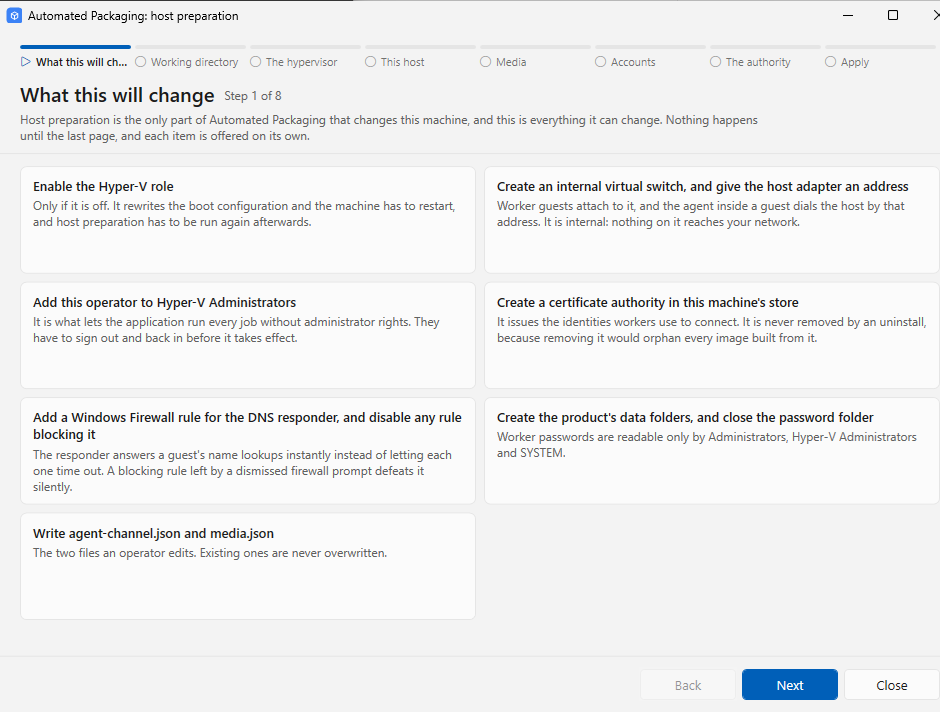
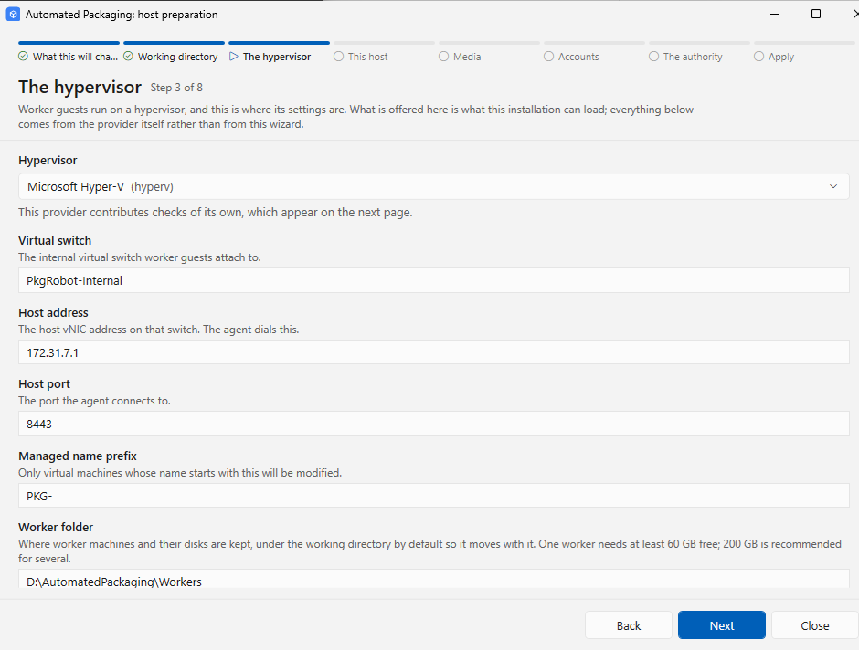
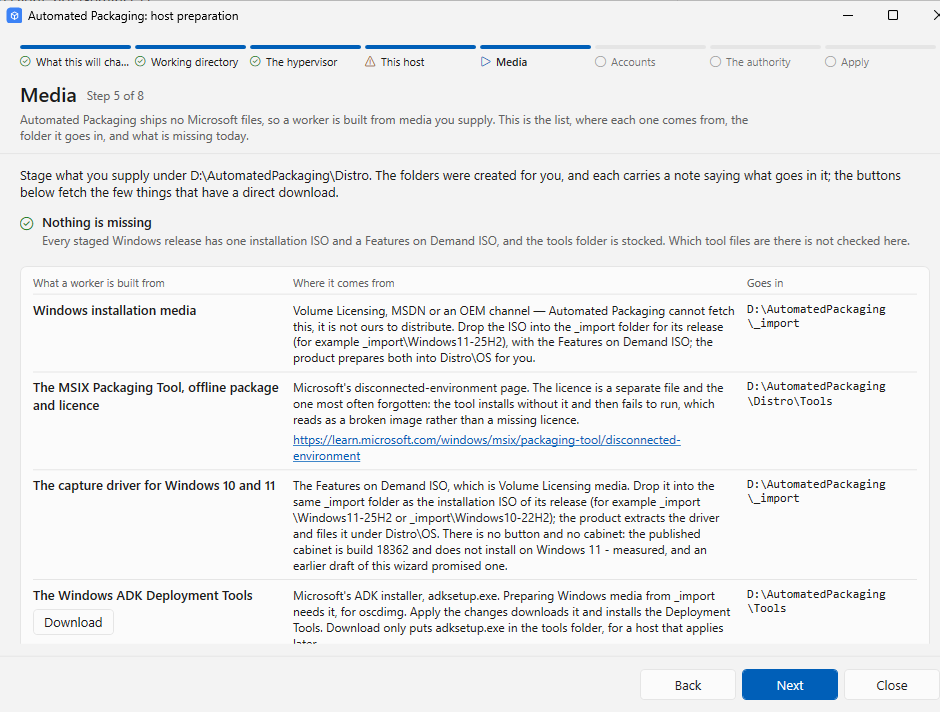

# Prepare the host

Host preparation is `AutomatedPackaging.PrepareHost.exe`, beside the application. It checks the host and fixes what it can: Hyper-V, an internal virtual switch, group membership, a certificate authority, firewall rules, the data folders and two configuration files.

=== "GUI"

    1. Start **Automated Packaging** from the Start menu.
    2. Go to **Settings > This host**, and click **Prepare this host…**.

    The wizard has eight pages, with a bar across the top. **Only the last page changes the host.** The blue button at the bottom right is the next step: **Next** on pages 1 to 7, then **Apply the changes**.

    

    | # | Page | What it does |
    |---|---|---|
    | 1 | **What this will change** | Lists every change to the host that host preparation can make |
    | 2 | **Working directory** | Shows the folder selected at installation, read-only, and the folders it creates in it |
    | 3 | **The hypervisor** | The Hyper-V settings: **Virtual switch** (`PkgRobot-Internal`), **Host address** (`172.31.7.1`), **Host port** (`8443`), **Managed name prefix** and **Worker folder** |
    | 4 | **This host** | All checks, in two tables. Filter on **In the way**, **Worth knowing** or **Fine**. The last column says what happens to each item. **Re-read this host** reads the host again |
    | 5 | **Media** | What a worker is built from, the folder for each item, and what is missing. **Download** gets `adksetup.exe` into `<workingDir>\Tools` |
    | 6 | **Accounts** | The account in a new worker (`pkgbuilder`), and its password |
    | 7 | **The authority** | The private certificate authority that workers use to authenticate. Created if it is not there |
    | 8 | **Apply** | Lists what **Apply the changes** fixes. After the run, it shows what is done, what did not work, and what is still in the way |

    !!! warning "Leave three settings at their defaults"
        - The application attaches workers to the switch `PkgRobot-Internal`, and keeps them in `<workingDir>\Workers`. Leave **Virtual switch** and **Worker folder** at their defaults on page 3.
        - **Managed name prefix** on page 3 shows `PKG-`. The application uses the prefix under **Settings > Advanced**, `PKGMGR-` by default.
        - Workers built from the Images screen always use the account `pkgbuilder` and a generated password, whatever page 6 shows.

    

    Page 5, **Media**, shows what a worker is built from, and the folder for each item:

    

    ### After Apply

    | The Apply page says | Do this |
    |---|---|
    | "This machine has to restart before they take effect…" | Click **Restart now**. The wizard opens again at your next sign-in, on the Apply page. Click **Apply the changes** again. Set again any value that you changed on the other pages |
    | "Sign out and back in before running a job…" | Sign out of Windows and sign in again. You are now in Hyper-V Administrators, and Windows reads the groups at sign-in |
    | "This host is ready. Restart Automated Packaging…" | Close the application and start it again. It reads `agent-channel.json` only when it starts |

=== "CLI"

    Run host preparation without a window, from an elevated prompt:

    ```
    AutomatedPackaging.PrepareHost.exe --check  [--report <path>]
    AutomatedPackaging.PrepareHost.exe --apply  [--report <path>]
    ```

    - `--check` changes nothing. It lists what `--apply` would do.
    - `--apply` fixes what it can.
    - `--set <name>=<value>` gives a hypervisor setting. `--help` shows the other options.

    | Exit code | Meaning |
    |---|---|
    | 0 | The host is ready |
    | 1 | Something still stops the host, or a fix was refused |
    | 2 | It could not run: incorrect arguments, or no hypervisor |
    | 3010 | Fixes applied. Restart the host, then run `--apply` again |
    | 3011 | Fixes applied. Sign out of Windows and sign in again |

    !!! note "In a script"
        The program is a window program that uses your console. In `cmd`, the prompt comes back before the report shows. To get the exit code, wait for the process: `start /wait` in `cmd`, or `Start-Process -Wait -PassThru` in PowerShell.

    The `--working-dir <path>` option is ignored on a host installed from the MSI. The registry value of the installer wins. Select the working directory with `WORKINGDIR=` at installation.

Each run writes a record to `<workingDir>\Logs\host-preparation-<date>-<time>.json`.

## Folder access

The application runs elevated. It runs the signing tools in `<workingDir>\Tools`, and it reads its settings from the data folder. So host preparation closes both folders to other accounts. Two checks on the **This host** page show the state.

**Working directory access** gives full control to `Administrators`, `SYSTEM` and `Hyper-V Administrators`, and **Modify** to `NT VIRTUAL MACHINE\Virtual Machines`. It removes the entries of other accounts in the folder tree. It also gives items owned by other accounts to `Administrators`. Read the list in the outcome: it names each item that it took back.

**Data folder access** gives full control to `Administrators`, `SYSTEM` and `Hyper-V Administrators` only. Standard users can then not read the data folder.

Host preparation stops and changes nothing if the folder tree holds a link: a junction, a symbolic link or a hard link. Remove the link, or move its target into the tree. Host preparation does not change the folders above the working directory. If another account can change one of them, the check says so. Correct that folder yourself.

A job does not start while another account can change the tools or the packages. It stops with `AP-SG-010` and names the account and the folder.

What this means every day:

- An Explorer window that is not elevated cannot open these folders. Use an elevated Explorer or PowerShell, or the application.
- If Explorer offers **Continue**, it adds an entry for your account. The checks accept this for an account that is directly a member of `Administrators`.

Next: [Stage media](stage-media.md).
