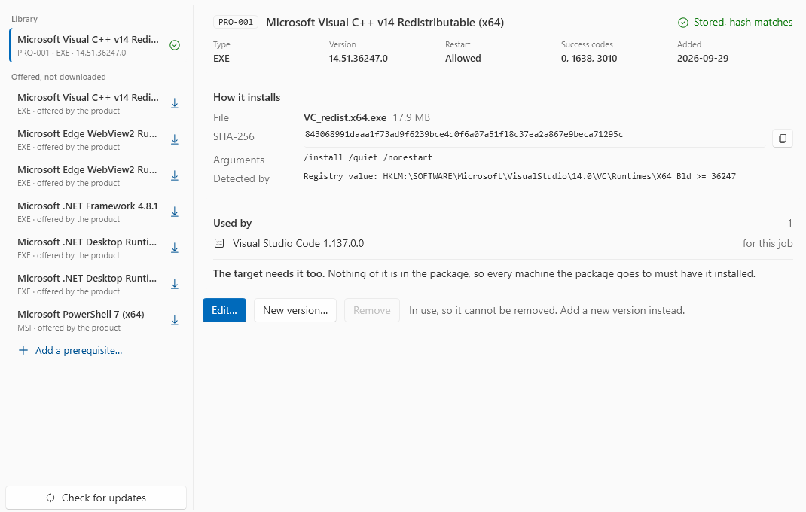

# Prerequisites

Some applications need a runtime before they start: the Visual C++ runtime, WebView2, a .NET runtime or a Windows feature. A prerequisite installs such a runtime on the worker, **outside** the package. You can put it on an image, or on one job.

!!! warning "A prerequisite is not in the package"
    Each machine that gets the package needs the same prerequisites first. The notes of the package say which ones.

## The library

**Prerequisites**, in the navigation, holds the library. Each item gets an ID when you add it, for example `PRQ-001`. An ID is never used again, also not after you remove the item. You manage the library in the application window. The command line uses the IDs.

The list has two groups:

- **Library**: the items stored on this host.
- **Offered, not downloaded**: items that the product can download from the vendor.

Select an item to see its facts, how it installs, and **Used by**: the images, jobs and items that use it.

The screen opens at once. While it reads the library and the files of each item, a ring shows above the list.



### Download from the vendor

Select an item under **Offered, not downloaded**, then click **Download**. The product keeps the file only when Windows accepts it as signed by Microsoft. Where the vendor publishes a hash, the hash must also match.

| Item | Source |
|---|---|
| Visual C++ v14 Redistributable (x64, x86) | Microsoft's permanent links |
| Edge WebView2 Runtime (x64, x86) | The Evergreen standalone installer |
| .NET Framework 4.8.1 | The offline installer |
| .NET Desktop Runtime 8.0 and 10.0 (x64) | Microsoft's .NET release data |
| PowerShell 7 (x64) | The PowerShell release on GitHub |

After the download, check the **On the target** text of the item, under **Edit…**.

**Check for updates**, under the list, asks the vendors for newer versions of these items. An item with an update shows an arrow, and **Update to …**.

### Add your own

Click **Add a prerequisite…**. An item has one of three types:

| Type | What runs |
|---|---|
| **EXE installer** | The file, with its arguments |
| **MSI package** | `msiexec /i <file> <arguments>`, with `/qn`, `/norestart` and a log added |
| **PowerShell script** | The script, in Windows PowerShell 5.1 or PowerShell 7 (**Engine**) |

**Items must install offline.** A worker has no route to the internet. A web installer fails.

The important fields:

| Field | What it is for |
|---|---|
| **Vendor**, **Name**, **Version** | What the item is |
| **Files** | The installer and the files it reads. **Select files…** copies them to `<workingDir>\Distro\Prerequisites\PRQ-nnn` |
| **Arguments** | The silent switches |
| **Success codes** | The exit codes that mean success, for example `0` |
| **Minutes allowed** | 1 to 240 minutes, default 30 |
| **Restart allowed** | When ticked, exit code 3010 or 1641 restarts the worker |
| **Detected by** | How the product finds the item: a file, a registry value, an MSI product code, or a script |
| **Needs first** | Items that this item needs first |
| **On the target** | What a target machine needs. This text goes into the notes of each package |

Click **Save**. The product records the hash of the files. A file changed by hand in `Distro\Prerequisites` stops the item with `AP-PK-012`.

To change the files, select **New version…**. The item keeps its ID.

## On an image

Prerequisites on an image install at step 7, before hardening. Use this for a runtime that many applications need: it installs once.

=== "GUI"

    On the **Build a worker** card, or on the card of an image, click **Prerequisites: Select…** and tick the items. On an existing image, click **Update** to install what you added.

=== "CLI"

    ```
    AutomatedPackaging.Cli worker build PKGMGR-002 --medium W11-25H2 --kms-server kms.example.com --prerequisite PRQ-001 --prerequisite PRQ-003
    ```

    `worker update` keeps the prerequisites of the image.

An update cannot remove a prerequisite from a machine. **Rebuild from media** builds a new Windows with exactly the selected items. A failure at step 7 is `AP-IM-022`.

## For one job

=== "GUI"

    On the **Build** screen, click **Prerequisites: Select…**.

=== "CLI"

    ```
    AutomatedPackaging.Cli convert D:\installers\app.msi --certificate-thumbprint <thumbprint> --prerequisite PRQ-002
    ```

For a job with prerequisites:

1. The worker goes back to `baseline`, and the items install. An item that the image has is not installed again.
2. The worker restarts once. A short calibration adds what the items changed to the exclusions of the job.
3. The worker makes the checkpoint `prerequisites`. The capture then does not see the items.
4. The smoke test uses the `prerequisites` checkpoint, so the package is tested with its prerequisites.
5. At the end, the worker goes back to `baseline`.

The items install again for each job. A failure is `AP-IN-014`.
