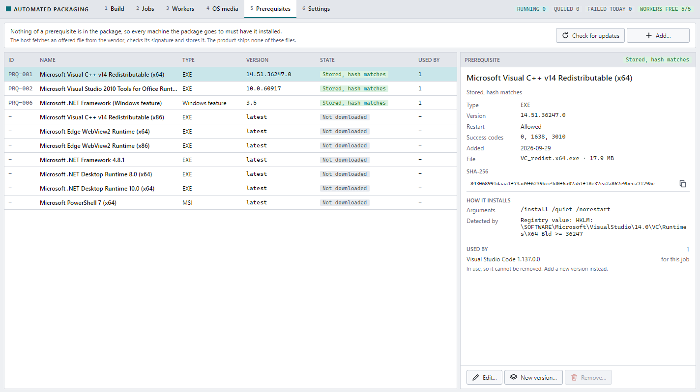

# Prerequisites

Some applications need a runtime before they start: the Visual C++ runtime, WebView2, a .NET runtime or a Windows feature. A prerequisite installs such a runtime on the worker, **outside** the package. You can put it on an image, or on one job.

!!! warning "A prerequisite is not in the package"
    Each machine that gets the package needs the same prerequisites first. The notes of the package say which ones.

## The Windows App SDK

A WinUI 3 application uses the Windows App SDK. Its vendor builds it in one of two ways:

- **Self-contained.** The application has the runtime, `Microsoft.WindowsAppRuntime.dll`, beside its bootstrapper, `Microsoft.WindowsAppRuntime.Bootstrap.dll`. The product packages it, and the package needs no Windows App SDK on the target.
- **Framework-dependent.** The application has the bootstrapper, but not the runtime. In a package, the bootstrapper stops the application before it starts. A prerequisite, or the Windows App SDK runtime on the target, does not change this. The product stops the job with `AP-PK-021` before it signs the package. The message names the bootstrapper.

For a framework-dependent application, get a self-contained build from the vendor. Or use the MSIX package of the vendor, if the vendor has one.

The packaging tool writes a dependency on `Microsoft.WindowsAppRuntime.1.4` into each package. The product removes it, because with it the package does not deploy. The note of step 7 in the job log tells if the package has the runtime.

## The library

The **Prerequisites** tab (Ctrl+6), between **OS media** and **Settings**, holds the library. Each item gets an ID when you add it, for example `PRQ-001`. An ID is never used again, also not after you remove the item. You manage the library in the application window. The command line uses the IDs.

The list has two kinds of rows:

- The items stored on this host. Each has its ID, and its **STATE** says if its files agree with their hash.
- The items that the product can download from the vendor. Their **STATE** says **Not downloaded**.

Select an item to see its facts, how it installs, and **Used by**: the images, jobs and items that use it.

The screen opens at once. While it reads the library and the files of each item, a moving bar shows "Reading the library and its files…".

A newer version of the product can store an item of a kind that this version does not know. You can see this after you go back to an earlier version, or restore a backup from a newer one. The list does not show such an item, and a message names it. The product keeps the item and its files as they are. An image or a job that asks for it is refused, with that reason. Update the product to use the item again.



### Download from the vendor

Select a row that says **Not downloaded**, then click **Download**. The product keeps the file only when Windows accepts it as signed by Microsoft. Where the vendor publishes a hash, the hash must also match.

| Item | Source |
|---|---|
| Visual C++ v14 Redistributable (x64, x86) | Microsoft's permanent links |
| Edge WebView2 Runtime (x64, x86) | The Evergreen standalone installer |
| .NET Framework 4.8.1 | The offline installer |
| .NET Desktop Runtime 8.0 and 10.0 (x64) | Microsoft's .NET release data |
| PowerShell 7 (x64) | The newest release on `github.com/PowerShell/PowerShell` that has a Windows MSI and a `hashes.sha256` file. Drafts and prereleases are not used |

The product does not keep a download in these conditions:

- The file is larger than 1 GiB. The largest item, the WebView2 x64 installer, was about 294 MB.
- The file changed after the download and before the check. The product hashes the file when the download ends, and again when it opens the file for the check. The two hashes must agree.
- The file has a second name on the drive (a hard link).

In each case, click **Download** again.

After the download, check the **On the target** text of the item, under **Edit…**.

**Check for updates**, above the list, asks the vendors for newer versions of these items. An item with an update shows **Update available**, and a button **Update to …**. For PowerShell 7, the check uses the same rule as the download: the newest release with a Windows MSI. The result tells you which release that is.

### Add your own

Click **Add…**. An item has one of four types:

| Type | What runs |
|---|---|
| **EXE installer** | The file, with its arguments |
| **MSI package** | `msiexec /i <file> <arguments>`, with `/qn`, `/norestart` and a log added |
| **PowerShell script** | The script, in Windows PowerShell 5.1 or PowerShell 7 (**Engine**) |
| **Windows feature** | DISM turns on a feature of Windows, such as .NET Framework 3.5. See [A Windows feature](#a-windows-feature) |

**Items must install offline.** A worker has no route to the internet. A web installer fails.

The important fields:

| Field | What it is for |
|---|---|
| **Vendor**, **Name**, **Version** | What the item is |
| **Files** | The installer and the files it reads. **Select files…** copies them to `<workingDir>\Distro\Prerequisites\PRQ-nnn` |
| **Arguments** | The silent switches |
| **Success codes** | The exit codes that mean success, for example `0` |
| **Minutes allowed** | 1 to 240 minutes, default 30 |
| **Restart allowed** | When ticked, exit code 3010 or 1641 restarts the worker |
| **Detected by** | How the product finds the item: a file, a registry value, an MSI product code, or a script |
| **Needs first** | Items that this item needs first |
| **On the target** | What a target machine needs. This text goes into the notes of each package |

Click **Save**. The product records the hash of the files. A file changed by hand in `Distro\Prerequisites` stops the item with `AP-PK-012`.

To change the files, select **New version…**. The item keeps its ID.

### A Windows feature

Some applications need a feature of Windows that is off, such as .NET Framework 3.5. Select the type **Windows feature**. Then click **Feature**, or press Alt+Down, to see the list. The list shows 16 features that applications often need. Each row has the name that Windows shows and the name that DISM knows. For example, `NetFx3` is ".NET Framework 3.5 (includes .NET 2.0 and 3.0)". The item keeps the DISM name.

When you select a feature, the product writes "Microsoft" in **Vendor** and the Windows name in **Name**, but only when the field is empty. A second selection replaces only the text that the first selection wrote. **Version** stays as you type it.

For a feature that is not in the list, type its name as DISM knows it. The product does not fill **Vendor** or **Name** for a typed name. `Get-WindowsOptionalFeature -Online` on a Windows machine shows the names. Letters, digits, dots, dashes and underscores only.

- The item has no files and no arguments. The source is the Windows installation ISO of the worker, which the worker keeps as a DVD. The product gives DISM the folder `sources\sxs` of that DVD, with `/LimitAccess`.
- The product finds the item by the state of the feature.
- DISM exits with 3010 when the feature needs a restart. **Restart allowed** is ticked for a new item.
- When **On the target** is empty, the notes of the package say "The Windows feature `<feature>`, enabled."

For .NET Framework 3.5 on Windows 10 and 11, use this type. The offline installer of Microsoft exits with 1603 there.

When an MSI needs .NET Framework 3.5 before it installs, the Build screen and `inspect` say so under **About this installer**, and name the feature `NetFx3`.

If DISM does not find the files, the item fails. The message names the Windows release of the worker and its DVDs. Rebuild the worker from its media if the DVD is missing.

**Limits.** A feature whose files are not in Windows and not in `sources\sxs` cannot be installed. Windows capabilities, such as language packs or RSAT tools, are not supported.

### A framework package (MSIX)

A package can need a framework package, such as `Microsoft.VCLibs.140.00.UWPDesktop` or the Windows App Runtime. Its AppxManifest names each one as a `PackageDependency`, with a lowest version. The [test of a package](jobs.md#test-a-package) installs these frameworks first. The product does not supply them: add each one as an item of type **Framework package (MSIX)**. The list shows the type as **Framework MSIX**.

- **Files**: one `.msix` or `.appx` file, the framework package itself. Get it from Microsoft or from the vendor of the application. Use the architecture of the packages that you test, mostly x64.
- **No arguments and no detection rule.** The worker is reverted after each test, so the framework is never on it already.
- The host sends the file to the worker with its SHA-256. The agent checks the hash, then installs the file together with the package. A file with another hash is not installed (`AP-PK-012`).
- **Vendor**, **Name** and **Version** are labels for you. The product does not use them to find the item. It reads the identity in the AppxManifest of the file: the name, the publisher, the version and the architecture.

The test takes the item whose name and publisher are the same as the dependency. Its architecture is the architecture of the package (x64 for a neutral package), or neutral. Its version must be the lowest version of the dependency or later. When more than one item agrees, the test takes the highest version.

An image, a conversion job and **Needs first** do not offer an item of this type. A choice that names one is refused.

## On an image

Prerequisites on an image install at step 8, before hardening. Use this for a runtime that many applications need: it installs once.

=== "GUI"

    In the **Build a worker** window, or in the Update window of a worker, click **Select…** beside **Prerequisites** and tick the items. For an existing image, click **Update** in the Update window to install what you added.

=== "CLI"

    ```
    AutomatedPackaging.Cli worker build PKGMGR-002 --medium Windows11-25H2 --kms-server kms.example.com --prerequisite PRQ-001 --prerequisite PRQ-003
    ```

    `worker update` keeps the prerequisites of the image.

An update cannot remove a prerequisite from a machine. **Rebuild from media…** builds a new Windows with exactly the selected items. A failure at step 8 is `AP-IM-022`.

## For one job

=== "GUI"

    On the **Build** screen, tick the items under **Prerequisites**, in column 3. **Library…** opens the **Prerequisites** tab.

=== "CLI"

    ```
    AutomatedPackaging.Cli convert D:\installers\app.msi --certificate-thumbprint <thumbprint> --prerequisite PRQ-002
    ```

For a job with prerequisites:

1. The worker goes back to `baseline`, and the items install. An item that the image has is not installed again.
2. The worker restarts once. A short calibration adds what the items changed to the exclusions of the job.
3. The worker makes the checkpoint `prerequisites`. The capture then does not see the items.
4. The smoke test uses the `prerequisites` checkpoint, so the package is tested with its prerequisites.
5. At the end, the worker goes back to `baseline`.

The items install again for each job. A failure is `AP-IN-014`.
