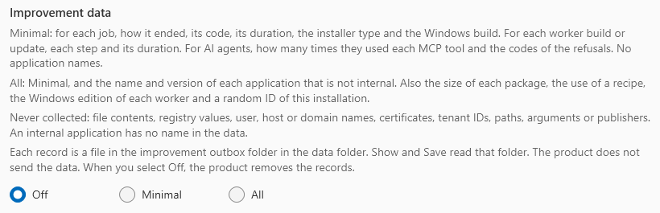

# Settings

The **Settings** screen has these sections. Settings are set in the application window. The command line uses them, and cannot change them. The exclusion list is the exception: the command line can change it too. See [Exclusions](#exclusions).

| Section | What it holds |
|---|---|
| **Licence** | The licence state and the starter allowance. **Install licence…** installs a licence file |
| **Folders** | The finished packages folder, the working directory, the data folder, and **Housekeeping** |
| **This host** | The host checks, **Prepare this host…**, Hyper-V, **Packaging tools** and **Package Support Framework** |
| **Signing** | Signing certificates, a test certificate, and Azure Artifact Signing profiles. See [Signing](signing.md) |
| **AI agents (MCP)** | How to connect an MCP client, and what an agent may do. See [AI agents (MCP)](mcp.md) |
| **Appearance** | **Follow Windows**, **Light** or **Dark** |
| **Export** | The export location. See [Export packages](export.md) |
| **Exclusions** | What a capture leaves out of a package, layer by layer. See [Exclusions](#exclusions) |
| **Diagnostics** | **Collect support information**, and **Improvement data** |
| **Advanced** | The managed name prefix, the default conversion engine, and the configuration bundle |

## This host

The application checks the host when it starts, when host preparation closes, and when you click **Check this host**. **Prepare this host…** starts host preparation. See [Prepare the host](prepare-host.md).

### Package Support Framework

Some applications write into their own installation folder. A package does not allow this. The Package Support Framework (PSF) puts a launcher in front of the programs of the application. It redirects such a write to a copy for each user.

The product uses Tim Mangan's release of PSF, pinned at `v2026.07.01`. It does not ship PSF. Most jobs do not need it.

1. On the card **Package Support Framework**, click **Get PSF**. The product downloads the release from GitHub, and the Visual C++ runtime from Microsoft.
2. In the **Advanced** settings of a job, turn on **Package Support Framework**. On the command line, give `--psf` to `convert`.

The product keeps the files only when each PSF file is signed by TMurgent Technologies LLP, and each runtime file by Microsoft. Before each job with PSF, it checks the files again. A file that fails stops the job with `AP-PK-011`.

The smoke test checks the fixup. It reads the modules of the started application. The job log names the fixup that it found. When the fixup did not load, the job shows a warning. When the modules could not be read, the job log says so.

When a newer PSF release is available, a notice shows above every screen. Jobs use your current release until you click **Adopt**.

## Appearance

The application follows the app mode of Windows by default. **Light** or **Dark** overrides it. The choice applies at once, and only for your account.

## Exclusions

An exclusion is a path that a capture leaves out of a package. **Settings > Exclusions** shows all the exclusions that a job uses, in layers:

| Layer | Where it comes from | What you can do |
|---|---|---|
| **Built-in rules** | The product. `FL-001` to `FL-004` are for the packaging tool. `BI-001` and up are for the built-in engine | Read them. Click **Turn off** to stop a rule on this host. `FL-001` and `FL-002` stay on |
| **This host** | You | Add, change and remove rules. Export them to a file, and import them on a different host |
| **Image** | The calibration of the image, when it was built or updated | Read them. An **Update** of the image calibrates them again |
| **Job** | The **Additional exclusions** of the job, in its **Advanced** settings | Change them for each job |
| **Recipes** | The recipes of this host, with the name, version, application, SHA-256 and problems of each. See [Recipes](recipes.md) | Read them. Add a recipe with the command line |

=== "GUI"

    Open **Settings > Exclusions**. The section reads the list again each time you open it.

=== "CLI"

    ```
    AutomatedPackaging.Cli exclusions list
    AutomatedPackaging.Cli exclusions list --json
    ```

    The list shows each built-in rule with its ID and its state: `on`, `off` or `always-on`. Then it shows the rules of this host with their IDs and notes. Then, for each image, it shows the set for the packaging tool and how many entries the built-in engine calibrated. Run the `exclusions` commands from an elevated prompt. They can run while the window is open.

An AI agent can read the list with the MCP tool `list_exclusions`. MCP cannot change the list. See [AI agents (MCP)](mcp.md).

### The image's calibration

The **Image** card shows the set of the selected image for the packaging tool. Below the set, a line tells how many entries the built-in engine calibrated on the image. The built-in engine leaves these entries out of each capture on that image. An image with no calibration of the built-in engine cannot run the built-in engine. An **Update** of the image calibrates it. You cannot change the sets of an image.

### Write a rule

A rule names one path. It removes the path and all that is below it. A rule has no wildcards. Write the rule in one of these forms:

- A full path, for example `C:\ProgramData\Vendor\Logs`.
- A path in the profile of the packaging account, for example `%USERPROFILE%\AppData\Local\Vendor`.
- A registry key, for example `HKLM\SOFTWARE\Vendor\Telemetry` or `HKCU\Software\Vendor`.
- A service, for example `SERVICE\VendorUpdate`.

Both engines use the same rules. The product gives each engine the rule in the form that it reads. The product refuses a rule that removes a whole drive, a whole hive or the whole profile. It also refuses the whole `HKCU\Software\Classes` key, because the package then loses its COM and file type keys.

=== "GUI"

    1. Type the rule in the box. Optionally, type a note.
    2. Click **Add**.

    To change a rule, select it, click **Edit**, change the boxes, and click **Save change**. To remove a rule, select it and click **Remove**.

=== "CLI"

    ```
    AutomatedPackaging.Cli exclusions add "C:\ProgramData\Vendor\Logs" --note "Logs of the vendor"
    AutomatedPackaging.Cli exclusions change HO-001 "HKLM\SOFTWARE\Vendor\Telemetry"
    AutomatedPackaging.Cli exclusions remove HO-001
    ```

    `exclusions add` gives the ID of the new rule. `exclusions change` keeps the ID, and keeps the note when you give no `--note`. A rule that the screen refuses is refused here too, with the same reason, and exit code 1.

The next job uses the change. A job that runs now keeps the rules that it started with.

### IDs and the evidence of a job

Each rule has an ID. A rule of this host is `HO-001`, `HO-002` and up. The ID of a removed rule is not used again. Each job writes `exclusions.json` into its folder. The file lists each rule that the job used, each rule that is off, and what each engine got. The evidence of the built-in engine gives the ID of the rule that removed each entry.

### Turn off a built-in rule

!!! warning
    Turn off a built-in rule only when a package needs what the rule removes. Without the rule, the packages that this host makes can hold files and keys that Windows wrote by itself.

=== "GUI"

    Click **Turn off** beside the rule, and then click **OK**. Click **Turn on** to use the rule again.

=== "CLI"

    ```
    AutomatedPackaging.Cli exclusions turn-off FL-003
    AutomatedPackaging.Cli exclusions turn-off FL-003 --confirm
    AutomatedPackaging.Cli exclusions turn-on FL-003
    ```

    Without `--confirm`, the command shows what the rule removes and the warning, and changes nothing.

`FL-001` and `FL-002` stay on. While a built-in rule is off, the Settings list shows a warning sign beside **Exclusions**.

### Export and import

The export file holds the rules of this host and the built-in rules that are off. An import adds the rules of such a file that this host does not have. It also turns off the built-in rules that the file turned off. If one rule in the file is not correct, the product imports nothing.

=== "GUI"

    Click **Export…** and select a file. On the other host, click **Import…** and select the file.

    If the list turns off built-in rules that are on here, the application names them and asks first, as it does for one rule. Click **OK** to import, or **Cancel** to import nothing.

=== "CLI"

    ```
    AutomatedPackaging.Cli exclusions export D:\Exports\exclusions.json
    AutomatedPackaging.Cli exclusions import D:\Exports\exclusions.json
    ```

    `exclusions export` does not write over a file. Give the name of a new file.

    `exclusions import <file> [--confirm] [--json]`: Adds the rules of a file that `exclusions export` or **Export…** made. It skips the rules that the list has already. It turns off the built-in rules that the file turned off. If the file turns off a built-in rule that is on, give `--confirm`. Without it, the command names the rules, shows the warning and changes nothing. A file with one bad rule adds nothing.

## Diagnostics

**Collect support information** writes one zip file for AppVentiX support to `<dataFolder>\diagnostics\`.

1. Tick the jobs whose logs go in, at most 10. The newest failed job is ticked when you open the section.
2. Click **Collect support information**.

The screen gives the path of the file, what is in it and what redaction replaced. The file holds:

- the product version, the operating system, the data folder and the licence state,
- the checks of **This host**,
- the 20 newest jobs, and the logs of the jobs that you ticked,
- the images, workers, claims and holds of this host,
- the logs of the last 7 days, also the MCP audit log.

Before a file goes into the zip file, redaction replaces these values with a numbered name, for example `<host-1>`:

- the names of this host, its domain and its users, and the name of the licence holder,
- certificates, certificate subjects, thumbprints, GUIDs such as tenant IDs,
- e-mail addresses, domain names, IP addresses, server and share names,
- folder names outside the data folder, the working directory, Windows, Program Files and ProgramData (file names stay),
- registry values, and the values of MSI properties and installer switches (their names stay).

Redaction cannot find a name that it does not know, for example the name of another computer in a log line. Read the file before you send it. The product does not send the file.

It does not hold worker passwords, the licence file, installers or packages. Not in the file: the `Collected files` folder of a job, and the host preparation records. Attach them yourself when necessary. They are not redacted.

An AI agent can write the same file with the MCP tool `collect_support_bundle`. See [MCP](mcp.md).

### Improvement data

**Improvement data** helps AppVentiX make the product better. Select a level: **Off**, **Minimal** or **All**. Off is the default. The installer asks for the level. While the level is not Off, the host keeps one record for each job, each worker build and each worker update. The support information does not contain these records.

Settings and `improvement set` also write the level that they save to the value of the installer. Without `IMPROVEMENTDATA`, a silent installation uses the value that is there, or Off.

**At an upgrade**, the question shows the level of this host: the level saved on Settings or with the command line, else the answer of the install before. If you select a different level, or give a different `IMPROVEMENTDATA`, the product uses it. If the answer is the same, the level stays. When the level goes down, or a policy limits it, the product removes the records of a higher level. It does this when the application starts and when the host service starts.

If the product cannot write the value, Settings and `improvement set` save the level and tell you. Then the question at an upgrade can show an earlier level. The application writes the value again each time it starts.

=== "GUI"

    Go to **Settings > Diagnostics**, section **Improvement data**. Select **Off**, **Minimal** or **All**. A level above the policy of your organisation is not available. Then the line under the buttons says, for example, "Set by your organisation: Minimal at most."

    

=== "CLI"

    | Command | What it does |
    |---|---|
    | `improvement [--json]` | Shows the improvement data level of this host: Off, Minimal or All, and how many records the outbox has. If a policy of your organisation limits the level, it says "Set by your organisation" |
    | `improvement set <Off\|Minimal\|All> [--json]` | Sets the improvement data level, as **Settings > Diagnostics** does. A level above the policy of your organisation is refused with exit code 1. Off removes the records. The level is also written for the question at an upgrade |

**Minimal collects:**

- For a job: how it ended, its error code, its duration and the exit code of the installer.
- For a job: MSI or EXE, the install mode, the target, and the number of MSI properties, transforms and prerequisites.
- For a job: the Package Support Framework and the export on or off, and the Windows build.
- For a job: the versions of the packaging tool and the agent, and the conversion engine.
- For a worker build or update: how it ended, the step that failed, its error code and the duration of each step.
- For AI agents: how many times they called each MCP tool, and the error codes of the refusals. Only the days since the level was set.

**All also collects:**

- For a job: the name and the version of the application, if it is not internal.
- For a job: the size of the package, and if the job used a recipe.
- The Windows edition of each worker.
- A random ID of this installation. Off removes the ID, and All later makes a new one.

**Never collected:**

- File contents, registry values, user, host and domain names, certificates and publishers, and tenant IDs.
- Paths, installer arguments, MSI property values, worker and image names, job IDs and error text.
- The time of day. A record has the date only.
- The account of an AI agent's client, its arguments and the text of the answers.

**The name of an application.** Only All collects names. Tick **Internal** on the Build screen, or use `--internal` on the command line, for your own application. Then its jobs have no name and no version in the data. A name with a path, a domain name, or the name of this host or one of its users is also left out.

**The outbox.** Each record is a JSON file in `<dataFolder>\improvement\outbox`. The folder keeps the newest 5000 records.

1. Click **Show**. The screen shows the full file, exactly as **Save** writes it.
2. Click **Save**. The file goes to `<dataFolder>\diagnostics\automatedpackaging-improvement-<date>-<time>.json`.
3. Read the file before you send it. The product does not send the file.

When you select **Off**, the product removes the records and the outbox folder.

**A policy of your organisation.** An administrator can limit the level on each host with a registry value. The product then uses the lower of the two levels. Settings, `improvement` on the command line and the MCP tool `product_status` say "Set by your organisation". The levels above the policy are not available.

| Key | Value | Data |
|---|---|---|
| `HKEY_LOCAL_MACHINE\SOFTWARE\Policies\AppVentiX\AutomatedPackaging` | `ImprovementDataLevel` | `0` or `Off`, `1` or `Minimal`, `2` or `All` (REG_DWORD or REG_SZ) |

A value that is not one of these reads as Off. Set the value with Group Policy Preferences or with a script. The product reads it each time it writes a record, so a change applies at once.

**A silent install.** The property `IMPROVEMENTDATA` sets the level without the question:

```
msiexec /i AutomatedPackaging-<version>.msi /qn IMPROVEMENTDATA=Minimal
```

The installer writes the answer to `HKEY_LOCAL_MACHINE\SOFTWARE\AppVentiX\Automated Packaging`, value `ImprovementDataLevel`. The product uses it until a level is saved on Settings or with the command line. Without the property, a silent install uses Off, or the answer of the install before.

**Records from before 0.2.47.** Before 0.2.47 the setting was on or off, and the records were in the database. The product removes those records at the first start of 0.2.47. On becomes Minimal.

## Advanced

**The managed name prefix** is the prefix that each worker name must have, `PKGMGR-` by default. The product creates, changes and removes only machines with this prefix. Change it only if it is the same as names that you use. The prefix has 1 to 11 characters: letters, digits and hyphens. Click **Save prefix**, then start the application again. Earlier prefixes stay managed.

**The conversion engine** is the engine that converts the installer to a package. A job uses it when nobody selects an engine on the Build screen or on the command line. An MCP job uses Microsoft's MSIX Packaging Tool when the client gives no engine. **Microsoft's MSIX Packaging Tool** is the default. **Built-in engine (experimental)** is the product's own engine. A job on it needs a worker whose image records it. Select an engine and click **Save engine**.

**The configuration bundle** holds the configuration of this host, with its package identities. A package identity is how Windows knows that a new package updates an installed application. **Export configuration…** writes it, and **Import configuration…** reads it. The bundle holds no passwords, no private keys and no certificates.

## Worker limits

The file `agent-channel.json` in the data folder holds four limits on what a worker can do during a job. Most hosts do not need to change them. The service `AutomatedPackaging` runs the jobs, and it reads these limits only when it starts. Edit the file, then restart the service, for example with `Restart-Service AutomatedPackaging` in an elevated PowerShell. Do this when no job runs: a stop of the service stops each job that runs.

| Setting | Default | What it does |
|---|---|---|
| `maxJobUploadMegabytes` | `8192` | The most that one job can upload from its worker. One file can be half of it, so the package limit is 4 GB. Above it, the job fails with `AP-NW-007` |
| `maxJobLogMegabytes` | `64` | The most log text that one job can write |
| `agentHeartbeatSeconds` | `15` | How often the agent reports that it is there |
| `missedHeartbeatsAllowed` | `12` | How many reports can be missing before the worker is lost. The default is three minutes |

Before you raise the upload limit, look at the exclusion set of the image. The largest packages measured so far are about 2 GB.
