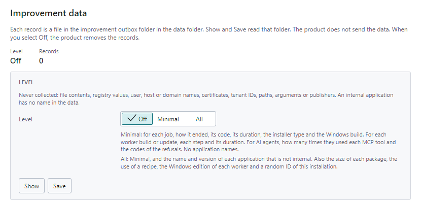

# Settings

The **Settings** tab (Ctrl+7) has these sections in a list at the left. **Find a setting**, above the list, finds a setting by a word. Settings are set in the application window. The command line uses them, and cannot change them. The exclusion list and the installer repair rules are the exceptions: the command line can change them too. See [Exclusions](#exclusions) and [Installer repair rules](#installer-repair-rules).

| Section | What it holds |
|---|---|
| **Licence** | The licence state and the starter allowance. **Install licence…** installs a licence file |
| **Product updates** | **Check for product updates**, in the card **Update check**. See [Product updates](#product-updates) |
| **Folders** | The finished packages folder, the working directory, the data folder, and **Housekeeping** |
| **This host** | The card **Host checks**, with **Check this host** and **Prepare this host…**. The cards **Packaging tools** and **Package Support Framework** |
| **Signing** | Signing certificates, a test certificate, and Azure Artifact Signing profiles. See [Signing](signing.md) |
| **AI agents (MCP)** | How to connect an MCP client, and what an agent may do. See [AI agents (MCP)](mcp.md) |
| **Appearance** | **Follow Windows**, **Light** or **Dark**, and the keyboard shortcuts of the window |
| **Export** | The export location. See [Export packages](export.md) |
| **Exclusions** | What a capture leaves out of a package, layer by layer, and the installer repair rules. See [Exclusions](#exclusions) |
| **Diagnostics** | **Collect support information**. See [Diagnostics](#diagnostics) |
| **Record steps** | Writes the steps that you do in the window to a file. See [Record steps](#record-steps) |
| **Improvement data** | **Off**, **Minimal** or **All**. See [Improvement data](#improvement-data) |
| **Advanced** | The managed name prefix and the default conversion engine |
| **Configuration** | The configuration bundle, and **Backup**. See [Configuration bundle](#configuration-bundle) and [Back up, restore and move](backup-restore.md) |

## This host

The application checks the host when it starts, when host preparation closes, and when you click **Check this host**. **Prepare this host…** starts host preparation. See [Prepare the host](prepare-host.md).

### Package Support Framework

Some applications write into their own installation folder. A package does not allow this. The Package Support Framework (PSF) puts a launcher in front of the programs of the application. It redirects such a write to a copy for each user.

An AppGo job does not use PSF.

The product uses Tim Mangan's release of PSF, pinned at `v2026.07.01`. It does not ship PSF. Most jobs do not need it.

1. On the card **Package Support Framework**, click **Get PSF**. The product downloads the release from GitHub, and the Visual C++ runtime from Microsoft.
2. In the **Advanced** settings of a job, turn on **Package Support Framework**. On the command line, give `--psf` to `convert`.

The product keeps the files only when each PSF file is signed by TMurgent Technologies LLP, and each runtime file by Microsoft. Before each job with PSF, it checks the files again. A file that fails stops the job with `AP-PK-011`.

The smoke test checks the fixup. It reads the modules of the started application. The job log names the fixup that it found. When the fixup did not load, the job shows a warning. When the modules could not be read, the job log says so.

After the download of PSF, the product asks GitHub at start if the fork has published a newer release. If it has, the product downloads that release one time, in the background. It checks that TMurgent Technologies LLP signed each of the eight files, and it keeps nothing. The product remembers the result for that release.

- **The files are signed.** A notice above each screen says that the release is available. The card offers **Adopt** with the name of the release. Jobs continue to use your release until you adopt the new one. Adopt downloads the release again and runs the same checks.
- **The files are not signed.** No notice shows. The card on **Settings > This host** shows one line: the release, the date of the release, and that it cannot be adopted. The card shows no **Adopt** button for that release. A newer release gets a new check.
- **Not now** hides the notice for that release. The notice shows again only for a newer release.
- **On a host with no internet**, the question gets no answer, and nothing shows.
- If **Adopt** refuses a release, the product says why, under **LAST ACTION** at the right of the section. It gives each reason one time, with the files under it. The product keeps the release that you have, and it does not offer the refused release again.

## Product updates

The application can tell you when AppVentiX publishes a newer version of the product. The setting is **Check for product updates**, in the card **Update check** on **Settings > Product updates**. It is on by default. The command line does not check for product updates.

When the check is on, the application sends one request when it starts. The request goes to an AppVentiX address over HTTPS. The server sees the IP address of this host and the product version. The application sends nothing else.

The answer is a file that AppVentiX signs with the key that also signs licences. The application uses the file only when the signature is correct. It also refuses a file with a lower issue number than the last file that it used. Thus an old file cannot hide a security update.

- **A newer version is available.** A notice shows above each screen. For a security update, the notice says so. Click **Download page…** or **Release notes…** to open the page in your browser.
- **The application does not download or install the update.** You download the MSI and install it yourself.
- **Not now** hides the notice until the next start.
- **On a host with no internet**, the check gets no answer, and nothing shows. It tries again at the next start.

The check is off, and the application sends no request, when you untick **Check for product updates**. It is also off in a build without an address for the update information: only a release of the product sets the address. Then the box is not available, and the card says why.

**Check for updates** on the **Prerequisites** screen is a different check. It looks for newer prerequisites.

## Appearance

The application follows the app mode of Windows by default. **Light** or **Dark** overrides it. The choice applies at once, and only for your account. Host preparation uses the same choice when it starts.

The card **Keyboard shortcuts** lists the shortcuts of the window. Ctrl+1 to Ctrl+7 open the tabs, from **Build** to **Settings**.

## Exclusions

An exclusion is a path that a capture leaves out of a package. **Settings > Exclusions** shows all the exclusions that a job uses, in layers:

| Layer | Where it comes from | What you can do |
|---|---|---|
| **Built-in rules** | The product. `FL-001` to `FL-022` are for the packaging tool. `BI-001` and up are for the built-in engine | Read them. Click **Turn off** to stop a rule on this host. `FL-001` and `FL-002` stay on |
| **Rules of this host** | You | Add, change and remove rules. Export them to a file, and import them on a different host |
| **Image** | The calibration of the image, when it was built or updated | Read them. An **Update** of the image calibrates them again |
| **Job** | The **Additional exclusions** of the job, in its **Advanced** settings | Change them for each job |
| **Recipes** | The recipes of this host, with the name, version, application, SHA-256 and problems of each. See [Recipes](recipes.md) | Read them. Add a recipe with the command line |

=== "GUI"

    Open **Settings > Exclusions**. The section reads the list again each time you open it.

=== "CLI"

    ```
    AutomatedPackaging.Cli exclusions list
    AutomatedPackaging.Cli exclusions list --json
    ```

    The list shows each built-in rule with its ID and its state: `on`, `off` or `always-on`. Then it shows the rules of this host with their IDs and notes. Then, for each image, it shows the set for the packaging tool and how many entries the built-in engine calibrated. Run the `exclusions` commands from an elevated prompt. They can run while the window is open.

An AI agent can read the list with the MCP tool `list_exclusions`. MCP cannot change the list. See [AI agents (MCP)](mcp.md).

### The image's calibration

The **Image** card shows the set of the selected image for the packaging tool. Below the set, a line tells how many entries the built-in engine calibrated on the image. The built-in engine leaves these entries out of each capture on that image. An image with no calibration of the built-in engine cannot run the built-in engine. An **Update** of the image calibrates it. You cannot change the sets of an image.

### Write a rule

A rule names one path. It removes the path and all that is below it. A rule has no wildcards. Write the rule in one of these forms:

- A full path, for example `C:\ProgramData\Vendor\Logs`.
- A path in the profile of the packaging account, for example `%USERPROFILE%\AppData\Local\Vendor`.
- A registry key, for example `HKLM\SOFTWARE\Vendor\Telemetry` or `HKCU\Software\Vendor`.
- A service, for example `SERVICE\VendorUpdate`.

Both engines use the same rules. The product gives each engine the rule in the form that it reads. The product refuses a rule that removes a whole drive, a whole hive or the whole profile. It also refuses the whole `HKCU\Software\Classes` key, because the package then loses its COM and file type keys.

=== "GUI"

    1. Type the rule in the box. Optionally, type a note.
    2. Click **Add**.

    To change a rule, select it, click **Edit**, change the boxes, and click **Save change**. To remove a rule, select it and click **Remove**.

=== "CLI"

    ```
    AutomatedPackaging.Cli exclusions add "C:\ProgramData\Vendor\Logs" --note "Logs of the vendor"
    AutomatedPackaging.Cli exclusions change HO-001 "HKLM\SOFTWARE\Vendor\Telemetry"
    AutomatedPackaging.Cli exclusions remove HO-001
    ```

    `exclusions add` gives the ID of the new rule. `exclusions change` keeps the ID, and keeps the note when you give no `--note`. A rule that the screen refuses is refused here too, with the same reason, and exit code 1.

The next job uses the change. A job that runs now keeps the rules that it started with.

### IDs and the evidence of a job

Each rule has an ID. A rule of this host is `HO-001`, `HO-002` and up. The ID of a removed rule is not used again. Each job writes `exclusions.json` into its folder. The file lists each rule that the job used, each rule that is off, and what each engine got. The evidence of the built-in engine gives the ID of the rule that removed each entry.

### Turn off a built-in rule

!!! warning
    Turn off a built-in rule only when a package needs what the rule removes. Without the rule, the packages that this host makes can hold files and keys that Windows wrote by itself.

=== "GUI"

    Click **Turn off** beside the rule, and then click **OK**. Click **Turn on** to use the rule again.

=== "CLI"

    ```
    AutomatedPackaging.Cli exclusions turn-off FL-003
    AutomatedPackaging.Cli exclusions turn-off FL-003 --confirm
    AutomatedPackaging.Cli exclusions turn-on FL-003
    ```

    Without `--confirm`, the command shows what the rule removes and the warning, and changes nothing.

`FL-001` and `FL-002` stay on. While a built-in rule is off, the Settings list shows a warning sign beside **Exclusions**.

`FL-005` to `FL-016` remove state of a different computer from a package that the packaging tool makes. A repackaged installer can hold this state from the computer that made it. Examples are the files and keys of the Edge browser of that user, and a cache of sign-in tokens. Other examples are the Start menu caches and the notification data of Windows. The package then carries the state to each computer. Three of these rules name files that Windows writes on the worker during a capture. The built-in engine removes the same state with its own rules.

| Rule | What it removes |
|---|---|
| `FL-005`, `FL-006` | The folders `Microsoft\Edge` and `Microsoft\TokenBroker` in `%USERPROFILE%\AppData\Local` |
| `FL-007` to `FL-009` | `C:\Windows\appcompat`, and the file `ngen.log` of .NET Framework 4 (64-bit and 32-bit) |
| `FL-010` to `FL-013` | `HKCU\Software\Microsoft\Edge`, and the keys of the Edge browser in the Edge updater. The keys of a WebView2 runtime stay |
| `FL-014` to `FL-016` | `CloudStore` and `UFH\SHC` in `HKCU\Software\Microsoft\Windows\CurrentVersion`, and `HKLM\SOFTWARE\Microsoft\Windows NT\CurrentVersion\Notifications\Data` |
| `FL-017` to `FL-021` | In `HKLM\SOFTWARE\WOW6432Node\Microsoft\EdgeUpdate`: the state of the Edge browser, the `CurrentState` keys of the updater and of the WebView2 Runtime, `UsageStats` and `PersistedPings` |
| `FL-022` | `C:\Windows\SystemTemp`, the temporary folder of programs that run as SYSTEM |

`FL-017` to `FL-021` remove what the Edge updater of the worker writes during a capture. The registration of a WebView2 Runtime stays in the package. An application reads that registration to find the runtime.

`FL-022` removes the temporary files that programs write when they run as SYSTEM. The Edge updater writes two files there when an installer updates it. It also tells Windows to delete these files at the next restart. Because the package does not hold the folder, the job does not stop for these deletes. The `C:\Windows\Temp` folder has no rule: a package keeps the files that an installer puts there.

### Export and import

The export file holds the rules of this host and the built-in rules that are off. An import adds the rules of such a file that this host does not have. It also turns off the built-in rules that the file turned off. If one rule in the file is not correct, the product imports nothing.

=== "GUI"

    Click **Export…** and select a file. On the other host, click **Import…** and select the file.

    If the list turns off built-in rules that are on here, the application names them and asks first, as it does for one rule. Click **OK** to import, or **Cancel** to import nothing.

=== "CLI"

    ```
    AutomatedPackaging.Cli exclusions export D:\Exports\exclusions.json
    AutomatedPackaging.Cli exclusions import D:\Exports\exclusions.json
    ```

    `exclusions export` does not write over a file. Give the name of a new file.

    `exclusions import <file> [--confirm] [--json]`: Adds the rules of a file that `exclusions export` or **Export…** made. It skips the rules that the list has already. It turns off the built-in rules that the file turned off. If the file turns off a built-in rule that is on, give `--confirm`. Without it, the command names the rules, shows the warning and changes nothing. A file with one bad rule adds nothing.

### Installer repair rules

Some MSI files hold registry rows from the computer that made them. A repackaging tool can copy them from its own computer. Examples are the run history of Windows, the proxy settings of a user, and files that the computer had to rename at its next start. On a worker, these rows can stop the installation, or send the connections of the worker to a proxy that is not there.

Before a job, the product reads the MSI with the installer repair rules. When a rule matches a row, the product makes a transform of its own for that job. The transform removes the rows from the installation. The MSI does not change. The job applies the transform after your own transforms, with both engines. Each row that a rule removes shows in the job log, with the code `AP-AN-014`.

The **Installer repair rules** card is a list of its own, beside the exclusions. An exclusion works after the installer, on what the capture found. A repair rule works before the installer, on the rows of the MSI.

| Rule | What it removes | Why |
|---|---|---|
| `IR-001` | `HKLM\SYSTEM\CurrentControlSet\Services\bam\State` and all keys below it | Windows writes this key for each program that ran. Windows protects it, and the installation fails with error 1406. This was measured on an installation for one user |
| `IR-002` | The values `ProxyEnable`, `ProxyServer` and `ProxyOverride` of `HKCU\Software\Microsoft\Windows\CurrentVersion\Internet Settings`, and the key `Wpad` below it | The proxy settings of the user who made the MSI. On the worker, they send connections to a proxy that is not there |
| `IR-003` | The values `PendingFileRenameOperations` and `PendingFileRenameOperations2` of `HKLM\SYSTEM\CurrentControlSet\Control\Session Manager` | The files that the computer which made the MSI had to rename or delete at its next start |
| `IR-004` | The value `Inno Setup: User` of each key in `HKLM\SOFTWARE\Microsoft\Windows\CurrentVersion\Uninstall` whose name ends with `_is1` | The name of the user who ran the original setup on the computer that made the MSI. The package carries the name to each computer. The other values of the key stay |
| `IR-005` | The values `LastUsedSource` and `InstallSource`, and the key `SourceList\Net`, in the registration that Windows Installer keeps for a product | The folder from which a different product was installed on the computer that made the MSI. The folder name can hold the name of a user. The registration of that product stays |

Only a built-in rule can have a `*` in a key. It stands for any characters in one key name.

The Build screen, `inspect`, `check` and the MCP tools `inspect_installer` and `check_job` show the rows before the job starts. The job writes `installer-repair.json` into its folder, with each rule that matched, its rows and the hash of the transform. The job also leaves out the copy of its transform that Windows Installer keeps for an installation for one user. `exclusions.json` lists it as rule `PR-001`.

An interactive job does not apply the transform: you run the installer yourself, and the job log names the rows. An EXE installer, or an MSI that writes these rows through a custom action, cannot be read before the job. The rules read the MSI only: a row that one of your transforms adds is not seen.

#### Turn off a repair rule

To keep the rows that a built-in rule removes, turn off the rule. The next job keeps them.

=== "GUI"

    Click **Turn off** beside the rule, and then click **OK**. Click **Turn on** to use the rule again.

=== "CLI"

    ```
    AutomatedPackaging.Cli repair-rules list
    AutomatedPackaging.Cli repair-rules turn-off IR-002
    AutomatedPackaging.Cli repair-rules turn-on IR-002
    ```

#### Add a repair rule

Write one registry key on each line:

- `HKLM\SOFTWARE\Vendor\Key` removes the key, its values and all keys below it.
- `HKCU\Software\Vendor\Key|Name` removes one value of the key.

A key starts with `HKLM`, `HKCU`, `HKCR` or `HKU`, and has at least two levels below the hive. A key has no wildcards. A row of the MSI with `-1` as its root is `HKCU` or `HKLM` at install time, so both match it. A row whose key holds a property, such as `[SID]`, does not match. A rule of this host gets the ID `IH-001`, `IH-002` and up. The ID of a removed rule is not used again.

=== "GUI"

    1. Type the keys in the box, one on each line.
    2. Type the reason. The job shows it with each row. Optionally, type a case.
    3. Click **Add**.

    To remove a rule of this host, click **Remove** beside it, and then click **OK**.

=== "CLI"

    ```
    AutomatedPackaging.Cli repair-rules add "HKCU\Software\Vendor\App\Recent Files" --reason "The recent files of the computer that made the MSI."
    AutomatedPackaging.Cli repair-rules remove IH-001
    ```

    Run the `repair-rules` commands from an elevated prompt. Put each key in quotes: a space or the `|` character splits it in the shell otherwise. A rule that the screen refuses is refused here too, with the same reason, and exit code 1.

The next job uses the change. A job that runs now keeps the rules that it started with.

## Configuration bundle

**Settings > Configuration** has the card **Configuration bundle**. **Export configuration…** writes one JSON file with the configuration of this host. You can keep it in a configuration repository, and import it on a new host. The command line has no command for the bundle. The file has:

- the package identities, and the signing history of each application;
- the signing profiles, by thumbprint only;
- the images, each with its build specification;
- the installer repair rules of this host, and the built-in repair rules that are off;
- the exclusions of this host, and the built-in exclusions that are off.

The file has no passwords, no private keys and no certificate content. The message after the export gives the number of each item.

**Import configuration…** adds what this host does not have. It changes nothing that is already here:

- A package identity that this host has with a different name stays as it is. The message names it.
- A signing profile needs its certificate on this host before it can sign.
- A repair rule or an exclusion that this host has already is not added again. A repair rule with the same keys is the same rule, also with a different reason.
- A new repair rule gets the next `IH-` ID of this host. A new exclusion gets the next `HO-` ID.
- The import checks each rule as **Add** does. If a rule is not correct, the import does not add it, and adds the other rules. The message names each rule that it did not add, with the reason.

If the file has built-in rules off that are on here, the import asks first. Click **Yes** to turn them off on this host too. Click **No** to keep them on: the import adds the other items. `FL-001` and `FL-002` always stay on. A rule that this version does not know also stays on.

A file of an earlier version has no rules. The import reads it and adds the other items.

## Backup

**Settings > Configuration** has the card **Backup**. **Back up now…** writes the job history and the settings of this host to a new folder. **Restore…** opens host preparation on its **Restore a backup** page, and closes the application. See [Back up, restore and move](backup-restore.md).

A backup is not the configuration bundle. The bundle carries settings between hosts and merges them. A backup holds the whole database, and a restore replaces it.

## Diagnostics

**Collect support information** writes one zip file for AppVentiX support to `<dataFolder>\diagnostics\`.

1. Tick the jobs whose logs go in, at most 10. The newest failed job is ticked when you open the section.
2. Click **Collect support information**.

The screen gives the path of the file, what is in it and what redaction replaced. The file holds:

- the product version, the operating system, the data folder and the licence state,
- the checks of **This host**,
- the 20 newest jobs, and the logs of the jobs that you ticked,
- the images, workers, claims and holds of this host,
- the logs of the last 7 days, also the MCP audit log.

Before a file goes into the zip file, redaction replaces these values with a numbered name, for example `<host-1>`:

- the names of this host, its domain and its users, and the name of the licence holder,
- certificates, certificate subjects, thumbprints, GUIDs such as tenant IDs,
- e-mail addresses, domain names, IP addresses, server and share names,
- folder names outside the data folder, the working directory, Windows, Program Files and ProgramData (file names stay),
- registry values, and the values of MSI properties and installer switches (their names stay).

Redaction cannot find a name that it does not know, for example the name of another computer in a log line. Read the file before you send it. The product does not send the file.

It does not hold worker passwords, the licence file, installers or packages. Not in the file: the `Collected files` folder of a job, and the host preparation records. Attach them yourself when necessary. They are not redacted.

An AI agent can write the same file with the MCP tool `collect_support_bundle`. See [MCP](mcp.md).

### Record steps

**Settings > Record steps** writes the steps that you do in the application to a file.
Support reads the file to see what happened before a problem.

1. Click **Start**.
2. Do the steps that cause the problem.
3. Go back to **Settings > Record steps** and click **Stop**.
4. Go to **Settings > Diagnostics** and click **Collect support information**. The zip file includes the steps file.

The file is `<workingDir>\Logs\steps-<date>-<time>.log`. Click **Show** to open it. Each start makes a
new file. Record steps stops after 30 minutes or 2000 steps, and when the application closes.

Each line has the time, the screen, the step and the name of the control. A step is a screen or a
dialog that opens, a button that you click, or a setting that you change. The name is the text that
the product gives the control, for example `Collect support information`.

| The control | What the line says |
|---|---|
| A button | Its name |
| A check box, a radio button or a switch | Its name and `on` or `off` |
| A text box or a password box | Its name and `changed`. One line each time that you go into the box and type |
| A list or a drop-down list | Its name and `changed` when you select an item |
| A control in an item of a list | Its type and the name of the list, for example `a button in the list JobList` |
| A dialog | The name of its class, not its title |

**Never in the file:** text that you type, passwords, paths, file names, the names of jobs, and the
text of the items in a list. The file has no pictures of the window, unless you tick **Take a
picture of the window for each step** (below). A message box is not a step.
`manifest.txt` names each steps file in the zip file.

An example of the lines:

```
# Automated Packaging Record steps. Names only, never values. It stops after 30 minutes or 2000 steps.
# Time | Screen | Step | Control | State
2026-11-14 00:00:47 | Settings > Appearance | screen opened | Settings > Appearance
2026-11-14 00:00:47 | Settings > Appearance | selection changed | Settings sections | changed
2026-11-14 00:01:08 | Settings > Diagnostics | screen opened | Settings > Diagnostics
2026-11-14 00:01:20 | Settings > Diagnostics | button clicked | Stop Record steps
# Stopped: You stopped Record steps.
```

#### Pictures of the window

Record steps can also keep one picture of the window for each step. Support then sees what the
screen showed, for example the state of a dialog. When a click closes a dialog, the picture of that step shows the window behind the dialog.

1. Tick **Take a picture of the window for each step**. The tick is off each time the application
   starts.
2. Click **Start**, do the steps, and click **Stop**.
3. Click **Review the pictures**.
4. Select each picture and look at it. **Next picture** goes to the next one that you did not see.
5. Untick **Keep this picture** for each picture that must not go to support. **Remove all**
   unticks all of them.
6. Click **Use the kept pictures**. The product deletes the pictures that you removed.
7. Go to **Settings > Diagnostics** and click **Collect support information**.

!!! warning "Redaction cannot read a picture"
    A picture can show host names, user names, job names and paths. Look at each picture before
    you keep it. Remove each picture that must not go to AppVentiX support.

The pictures are in `<workingDir>\Logs\steps-<date>-<time>-captures\step-<n>.png`. The number is
the step in the steps file. A picture shows only the window of the application, also when another
window is in front of it. Record steps keeps 100 pictures or 50 MB at most for each steps file. After
that, it writes only the steps, and the steps file says so.

**Use the kept pictures** is available only when you saw each picture that you keep. The zip file
takes a picture only after your review, and only if the picture did not change after it. A picture
that you did not review stays out, and `manifest.txt` says how many. After the application
restarts, review the pictures again. In the zip file, the pictures are in `captures\`.

### Improvement data

**Improvement data** helps AppVentiX make the product better. Select a level: **Off**, **Minimal** or **All**. Off is the default. The installer asks for the level. While the level is not Off, the host keeps one record for each job, each worker build and each worker update. The support information does not contain these records.

Settings and `improvement set` also write the level that they save to the value of the installer. Without `IMPROVEMENTDATA`, a silent installation uses the value that is there, or Off.

**At an upgrade**, the question shows the level of this host: the level saved on Settings or with the command line, else the answer of the install before. If you select a different level, or give a different `IMPROVEMENTDATA`, the product uses it. If the answer is the same, the level stays. When the level goes down, or a policy limits it, the product removes the records of a higher level. It does this when the application starts and when the host service starts.

If the product cannot write the value, Settings and `improvement set` save the level and tell you. Then the question at an upgrade can show an earlier level. The application writes the value again each time it starts.

=== "GUI"

    Go to **Settings > Improvement data**. Under **Level**, select **Off**, **Minimal** or **All**. A level above the policy of your organisation is not available. Then the line under the buttons says, for example, "Set by your organisation: Minimal at most."

    

=== "CLI"

    | Command | What it does |
    |---|---|
    | `improvement [--json]` | Shows the improvement data level of this host: Off, Minimal or All, and how many records the outbox has. If a policy of your organisation limits the level, it says "Set by your organisation" |
    | `improvement set <Off\|Minimal\|All> [--json]` | Sets the improvement data level, as **Settings > Improvement data** does. A level above the policy of your organisation is refused with exit code 1. Off removes the records. The level is also written for the question at an upgrade |

**Minimal collects:**

- For a job: how it ended, its error code, its duration and the exit code of the installer.
- For a job: MSI or EXE, the install mode, the target, and the number of MSI properties, transforms and prerequisites.
- For a job: the Package Support Framework and the export on or off, and the Windows build.
- For a job: the versions of the packaging tool and the agent, and the conversion engine.
- For a worker build or update: how it ended, the step that failed, its error code and the duration of each step.
- For AI agents: how many times they called each MCP tool, and the error codes of the refusals. Only the days since the level was set.

**All also collects:**

- For a job: the name and the version of the application, if it is not internal.
- For a job: the size of the package, and if the job used a recipe.
- The Windows edition of each worker.
- A random ID of this installation. Off removes the ID, and All later makes a new one.

**Never collected:**

- File contents, registry values, user, host and domain names, certificates and publishers, and tenant IDs.
- Paths, installer arguments, MSI property values, worker and image names, job IDs and error text.
- The time of day. A record has the date only.
- The account of an AI agent's client, its arguments and the text of the answers.

**The name of an application.** Only All collects names. Tick **Internal** on the Build screen, or use `--internal` on the command line, for your own application. Then its jobs have no name and no version in the data. A name with a path, a domain name, or the name of this host or one of its users is also left out.

**The outbox.** Each record is a JSON file in `<dataFolder>\improvement\outbox`. The folder keeps the newest 5000 records.

1. Click **Show**. The screen shows the full file, exactly as **Save** writes it.
2. Click **Save**. The file goes to `<dataFolder>\diagnostics\automatedpackaging-improvement-<date>-<time>.json`.
3. Read the file before you send it. The product does not send the file.

When you select **Off**, the product removes the records and the outbox folder.

**A policy of your organisation.** An administrator can limit the level on each host with a registry value. The product then uses the lower of the two levels. Settings, `improvement` on the command line and the MCP tool `product_status` say "Set by your organisation". The levels above the policy are not available.

| Key | Value | Data |
|---|---|---|
| `HKEY_LOCAL_MACHINE\SOFTWARE\Policies\AppVentiX\AutomatedPackaging` | `ImprovementDataLevel` | `0` or `Off`, `1` or `Minimal`, `2` or `All` (REG_DWORD or REG_SZ) |

A value that is not one of these reads as Off. Set the value with Group Policy Preferences or with a script. The product reads it each time it writes a record, so a change applies at once.

**A silent install.** The property `IMPROVEMENTDATA` sets the level without the question:

```
msiexec /i AutomatedPackaging-<version>.msi /qn IMPROVEMENTDATA=Minimal
```

The installer writes the answer to `HKEY_LOCAL_MACHINE\SOFTWARE\AppVentiX\Automated Packaging`, value `ImprovementDataLevel`. The product uses it until a level is saved on Settings or with the command line. Without the property, a silent install uses Off, or the answer of the install before.

**Records from before 0.2.47.** Before 0.2.47 the setting was on or off, and the records were in the database. The product removes those records at the first start of 0.2.47. On becomes Minimal.

## Advanced

**Settings > Advanced** has three cards.

**The managed name prefix** is the prefix that each worker name must have, `PKGMGR-` by default. The product creates, changes and removes only machines with this prefix. Change it only if it is the same as names that you use. The prefix has 1 to 11 characters: letters, digits and hyphens. Click **Save prefix**, then start the application again. Earlier prefixes stay managed.

**The conversion engine** is the engine that converts the installer to a package. A job uses it when nobody selects an engine on the Build screen or on the command line. An MCP job uses Microsoft's MSIX Packaging Tool when the client gives no engine. A new installation starts with **Built-in engine (experimental)**. An upgrade keeps the default of the host: **Microsoft's MSIX Packaging Tool** if nobody saved one. **Built-in engine (experimental)** is the product's own engine. A job on it needs a worker whose image records it. Select an engine under **Default conversion engine** and click **Save engine**.

**Worker internet** turns on the proxy that lets a job's worker reach the internet hosts that the job names. It is off by default. It also holds the port (default 3128), an optional upstream proxy (`host:port`), and the limit per job (default 2048 MB and 30 minutes). Click **Save worker internet**, then run host preparation for the firewall rule. See [Internet for a worker](worker-internet.md).

**Settings > Configuration** has the card **Configuration bundle**. It holds the configuration of this host, with its package identities. A package identity is how Windows knows that a new package updates an installed application. **Export configuration…** writes it, and **Import configuration…** reads it. The bundle holds no passwords, no private keys and no certificates.

## Worker limits

The file `agent-channel.json` in the data folder holds four limits on what a worker can do during a job. Most hosts do not need to change them. The service `AutomatedPackaging` runs the jobs, and it reads these limits only when it starts. Edit the file, then restart the service, for example with `Restart-Service AutomatedPackaging` in an elevated PowerShell. Do this when no job runs: a stop of the service stops each job that runs.

| Setting | Default | What it does |
|---|---|---|
| `maxJobUploadMegabytes` | `8192` | The most that one job can upload from its worker. One file can be half of it, so the package limit is 4 GB. Above it, the job fails with `AP-NW-007` |
| `maxJobLogMegabytes` | `64` | The most log text that one job can write |
| `agentHeartbeatSeconds` | `15` | How often the agent reports that it is there |
| `missedHeartbeatsAllowed` | `12` | How many reports can be missing before the worker is lost. The default is three minutes |

Before you raise the upload limit, look at the exclusion set of the image. The largest packages measured so far are about 2 GB.
