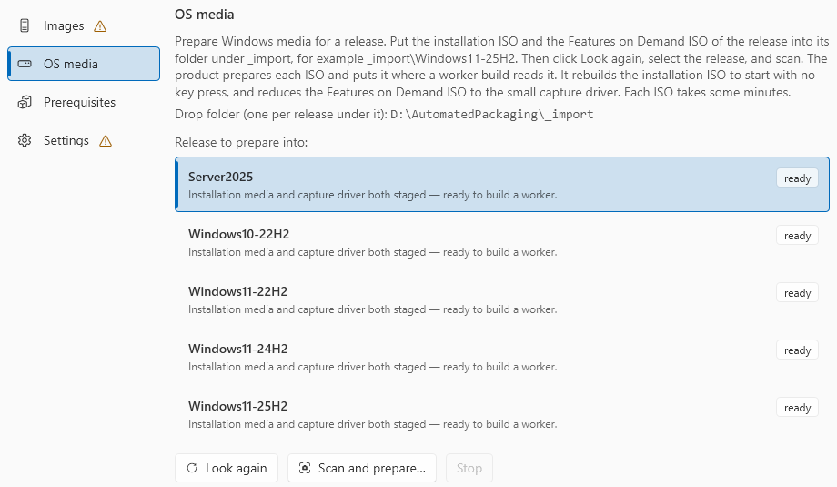

# Stage media

A worker is built from media that you supply. You put the files in folders of the working directory. The application then prepares the Windows ISOs. Media is prepared only in the application window. The command line has no command for it.

## 1. The packaging tool

You need **two files** from Microsoft: the tool bundle **and** its licence file. Download them on a computer with internet access.

1. Open Microsoft's page [Using the MSIX Packaging Tool in a disconnected environment](https://learn.microsoft.com/windows/msix/packaging-tool/disconnected-environment).
2. Under **Get the MSIX Packaging Tool**, click **Download 1.2024.405.0 MSIX Packaging Tool**. You get the bundle, for example `MSIXPackagingtoolv1.2024.405.0.msixbundle`.
3. Below it, click **Offline copy of the license**. You get the licence, for example `MSIXPackagingtoolv1.2024.405.0.License.xml`.
4. Put both files in `<workingDir>\Distro\Tools`. One copy serves all releases.

The two links go directly to `download.microsoft.com`. No sign-in is necessary. The version in the link text changes when Microsoft publishes a new release. Use the bundle and the licence of the same version.

!!! warning "The licence file is necessary"
    Microsoft's page offers the licence only "if you encounter issues". Automated Packaging always needs it. Without the licence, the tool installs and then does not run. Activation fails with `0x80072EE7`. This looks like a broken image, not like a missing file. A worker in this state fails with `AP-IM-009`.

The product finds the two files by their extension, not by their name:

- the first `.msix`, `.msixbundle` or `.appxbundle` file in the folder,
- the first `.xml` file in the folder.

So keep one bundle and one `.xml` file in `<workingDir>\Distro\Tools`, and no other `.xml` file. Use lowercase extensions: the product does not find `.MSIX` or `.MSIXBUNDLE`.

### Check that the product found the tool

=== "GUI"

    1. Go to **Settings > This host**, and click **Prepare this host…**.
    2. Go to page 4, **This host**. Find the row **Media**.

    | The row **Media** says | Meaning |
    |---|---|
    | "… discovered, with the capture driver and the packaging tool." | Both files are found |
    | "No packaging tool package. The product ships no Microsoft binaries." | The bundle or the licence is missing. The text does not say which. Look in `<workingDir>\Distro\Tools` for both files |

    The row **Working directory** says "The packaging tool is not staged in …" only when the folder is empty. Page 5, **Media**, also counts only whether the folder has files: "This page does not check which tool files are there."

=== "CLI"

    From an elevated prompt:

    ```
    AutomatedPackaging.PrepareHost.exe --check
    ```

    Find the check `product.media` in the report. It gives the same text as the row **Media** in the window.

If you build an image while a file is missing, the build stops at step 1, **Check this host**.

## 2. The ADK Deployment Tools

The application rebuilds the Windows ISOs with `oscdimg`, from the ADK Deployment Tools.

- **Apply the changes** in host preparation downloads `adksetup.exe` into `<workingDir>\Tools`. It then installs only the Deployment Tools.
- On a host with no internet, put `adksetup.exe` in `<workingDir>\Tools` first. `adksetup.exe` still downloads its payload from Microsoft during the installation.

To install the Deployment Tools manually:

```
adksetup.exe /ceip off /norestart /quiet /features OptionId.DeploymentTools
```

A download by the product keeps the file only when all three are true:

- Its name is `adksetup.exe`.
- It is smaller than 32 MB.
- Windows accepts it as signed by Microsoft.

## 3. The Windows media

For each release, put **both** ISOs in `<workingDir>\_import\<release>`. For example, `_import\Windows11-25H2`:

- the Windows installation ISO,
- the Features on Demand ISO of the same release.

The folder name tells the product the release of the two ISOs. See [Supported Windows releases](requirements.md#supported-windows-releases) for the folder names.

## 4. Scan and prepare

1. In the application, go to **OS media** in the navigation, below **Images**. While a release is not ready, the **OS media** entry shows a count, for example **2 waiting**. You see the count from all screens. The entry is grey until this host is prepared, as **Build** and **Images** are.
2. Click **Look again** after you add files or install the ADK. It reads the drop folders again, and checks again for `oscdimg`.
3. Select the release under **Release to prepare into**.
4. Click **Scan and prepare…**.



The scan reads each ISO in the drop folder of that release:

| ISO | What the scan does | Result |
|---|---|---|
| Windows installation ISO | Rebuilds it so that it starts with no key press | `Distro\OS\<release>\ISO\<name>-pkgmanaged.iso` |
| Features on Demand ISO | Reduces it to the capture driver | `Distro\OS\<release>\FOD\<release>-CaptureDriver.iso` |

A rebuild takes several minutes for each ISO. A bar and a line under the buttons show the ISO, the step and the time. The rest of the window stays available.

- **Stop** stops after the current ISO. The current ISO is completed first.
- The scan writes each ISO with a temporary name, `.iso.partial`. It renames the file only when it is complete. An ISO that was not completed never counts as staged.
- A release with both ISOs staged is not read again.

The release is ready when its row says "Installation media and capture driver both staged — ready to build a worker." Its badge then shows **ready**. The other badges are **partway** (one of the two ISOs) and **not staged**.

Next: [Build a worker image](build-image.md).
