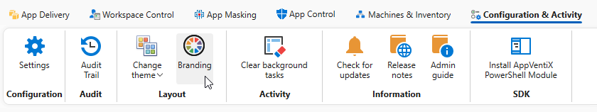
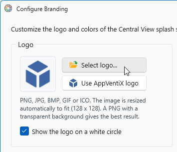
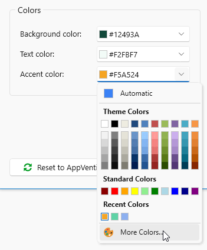
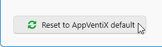
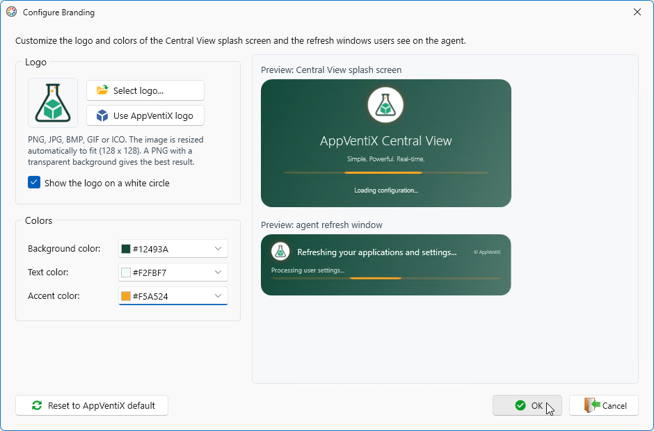
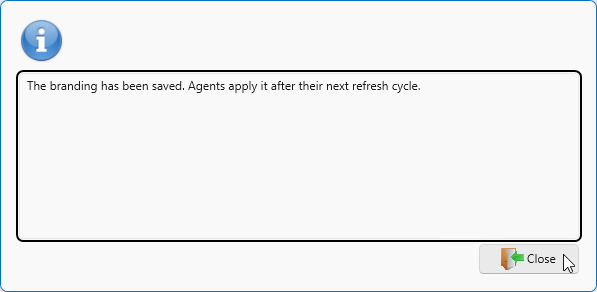

# Branding

As of version 5.4, AppVentiX supports branding. Use branding to give the management console and the AppVentiX Agent progress windows your company's own look and feel.

To configure branding, go to **Configuration & Activity** in the Central View app.

To change the logo, click **Select logo...** and select your own logo.

To change the **Background color**, **Text color**, or **Accent color**, click the arrow next to the color. Select a color from the list, or click **More Colors** to enter a custom color code.

To revert to the original AppVentiX colors, click **Reset to AppVentiX default**.

When you are done, click **OK** to save and close.

Click **Close**

